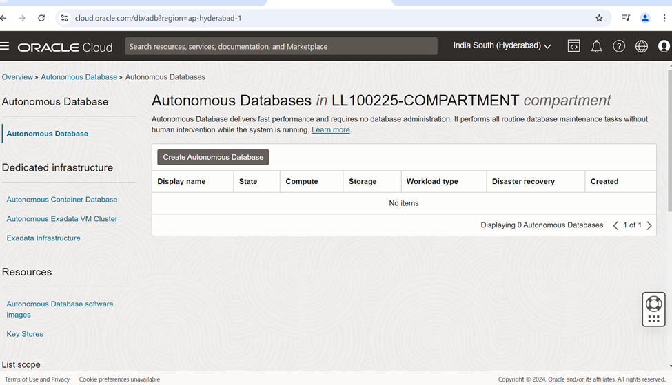
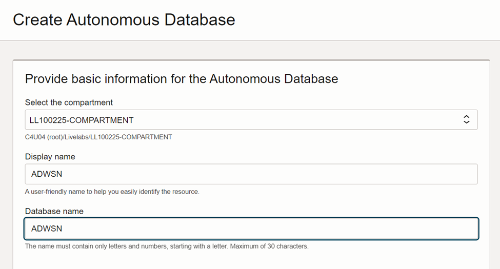
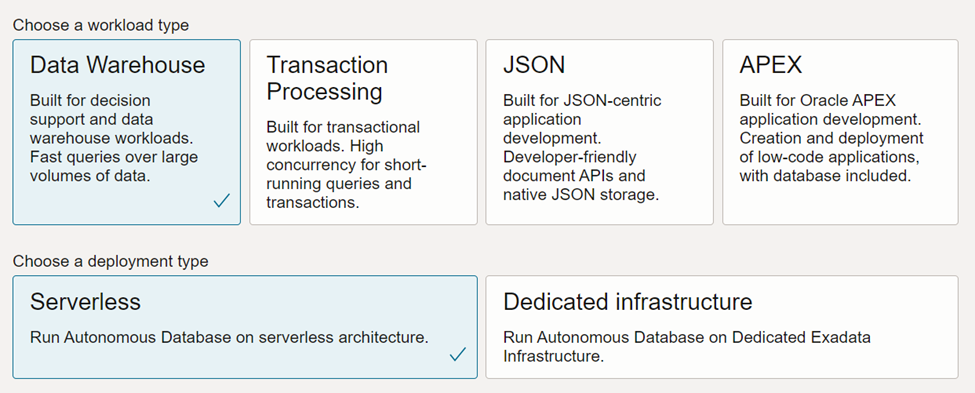
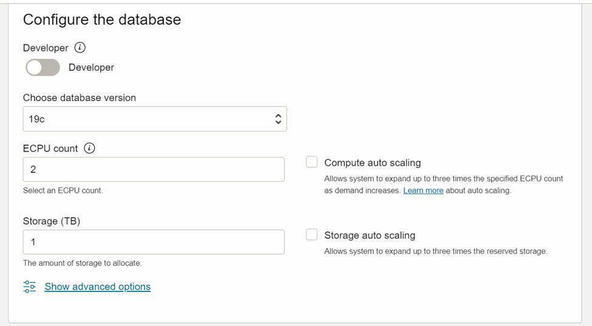
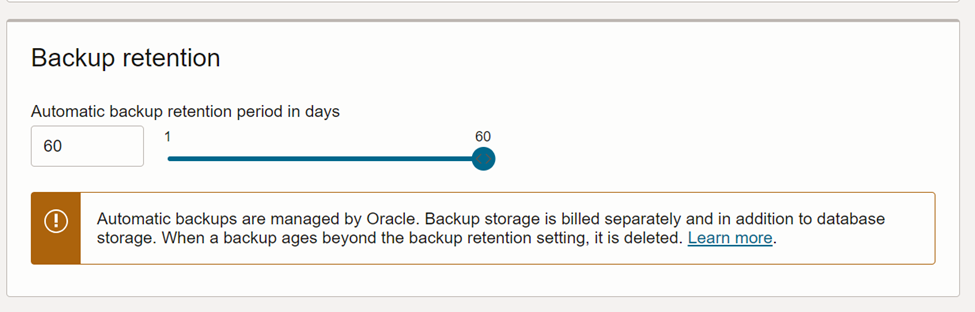
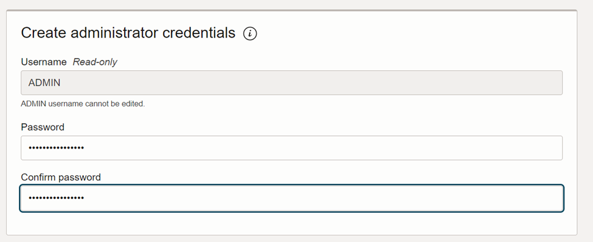
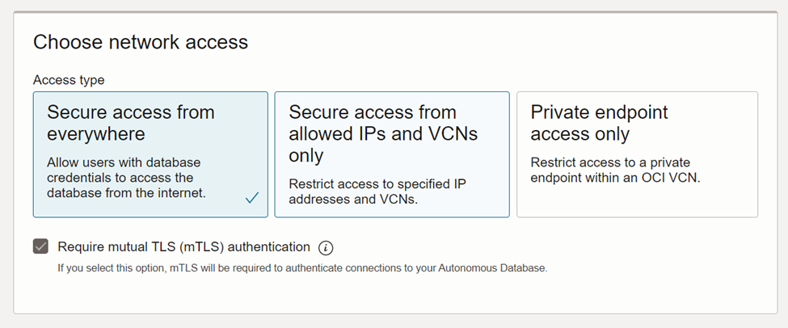
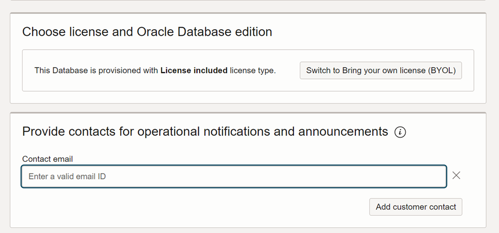

# Step-by-Step Guide to Deploy Oracle Autonomous Data Warehouse (ADW) on OCI

In today’s data-driven world, organizations need agile, secure, and scalable solutions for analytics and business intelligence. **Oracle Autonomous Data Warehouse (ADW)** delivers exactly that—an easy-to-deploy, fully managed database service optimized for analytical workloads.

This blog post walks you through the **complete steps to deploy an ADW instance on Oracle Cloud Infrastructure (OCI)**.

## 🔧 **1. Data Warehouse (ADW)**

- **Purpose**: Designed for **analytical workloads** such as reporting, dashboards, and business intelligence.
- **Optimized for**: Complex queries, large data scans, aggregations, and joins.
- **Use cases**:
  - Business Intelligence tools (e.g., Oracle Analytics Cloud, Tableau)
  - Data warehousing and ETL/ELT pipelines
  - Data lake integration

## 💼 **2. Transaction Processing (ATP)**

- **Purpose**: Built for **OLTP (Online Transaction Processing)** applications.
- **Optimized for**: High-speed, low-latency transaction processing with frequent reads/writes.
- **Use cases**:
  - Web and mobile apps
  - ERP/CRM systems
  - E-commerce platforms

## 🧪 **3. JSON Database**

- **Purpose**: Optimized specifically for **document-based applications** using JSON.
- **Optimized for**: Fast ingestion, storage, and querying of JSON documents with SQL and NoSQL APIs.
- **Use cases**:
  - NoSQL apps needing relational integration
  - Flexible schema applications
  - Mobile backend services

## 🧩 **4. APEX Workload (Autonomous APEX Service)**

- **Purpose**: Specifically tailored for building and deploying **low-code web apps** using **Oracle APEX**.
- **Optimized for**: Lightweight, form-based applications, dashboards, and reports.
- **Use Cases**:
  - Internal business apps
  - Dashboards and reports
  - Forms automation
  - non-coders building apps

### 📅 **Backup Retention Period**

- The **default backup retention** is \*\*\*\***60 days** for **paid** instances.
- For **Always Free** instances, backups may not be retained or guaranteed.

### 🔘 **Network Access Options**

You’ll be prompted to choose between the following:

### 1️⃣ **Secure Access from Everywhere (Public Endpoint)**

- **Description**: Database is assigned a public IP accessible via the internet.
- **Use Case**: Fast and easy access for developers, testing, and PoCs.
- **Security**: Controlled by **Access Control List (ACL)** — restrict by IP/CIDR.
- **Example**: Access from SQL Developer running on your laptop.

✅ Pros:

- Simple to set up
- Ideal for small or temporary apps

⚠️ Cons:

- Exposed to public internet (though secured via ACL & SSL)

### 2️⃣ **Secure Access from Inside VCN (Private Endpoint)**

- **Description**: Database is only accessible **within your VCN (Virtual Cloud Network)**.
- **Use Case**: Production workloads that require **private connectivity**.
- **Security**: Controlled via **VCN Subnets** and **OCI Security Lists** or **NSGs**.
- **Example**: Backend service in OCI talking to the Autonomous DB privately.

✅ Pros:

- More secure (no public IP)
- Better for enterprise apps and compliance

⚠️ Cons:

- Requires networking setup understanding (VCN, Subnets, NSG)
- Not accessible from the public internet

### 🔒 **Private Endpoint Access – Oracle Autonomous Database**

- **Description**: Deploys the Autonomous Database **without a public IP**, making it accessible **only within a specified VCN (Virtual Cloud Network)** in OCI.
- **Use Case**: Production-grade workloads with strict security requirements
- **Security**: **Highest security level**: No public exposure, Access restricted to **private subnet**,Controlled via **NSGs/Security Lists**
- **Example**: An e-commerce app running on OCI Compute needs to access Autonomous Database via private IP within the same VCN — no public access allowed.

OCI will start provisioning the database. This typically takes **2–3 minutes**.

## 🎯 Final Thoughts

Deploying Oracle Autonomous Data Warehouse on OCI is fast, intuitive, and doesn't require deep DBA expertise. With built-in intelligence, elastic scalability, and integrated analytics tools, it’s a game-changer for data professionals looking to accelerate insights.
