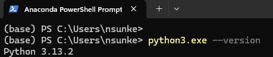
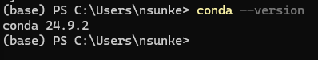
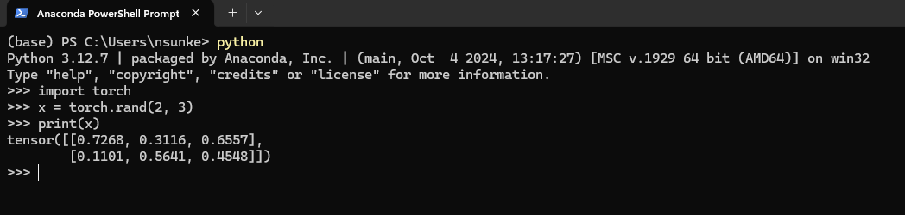
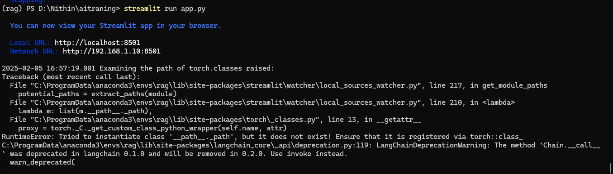
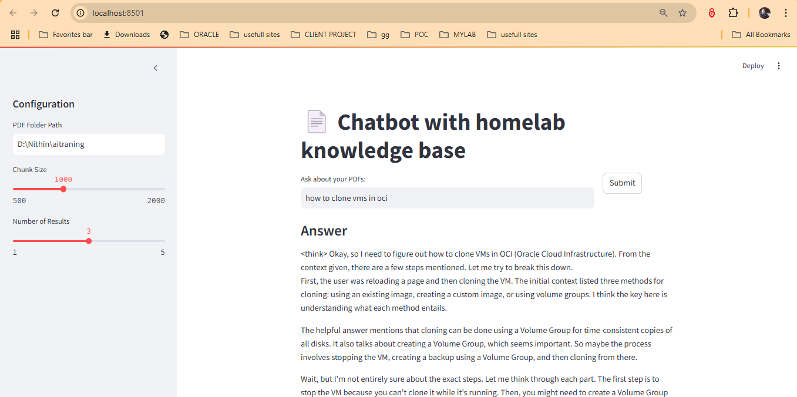

# Step-by-Step Guide to Train llm(Deepseek-R1) with PDF Articles Using Ollama on Windows 11

## **1. Verify Hardware Setup**

- Ensure you have sufficient hardware:
  - **RAM** : At least 16GB is recommended for smooth operation.
  - **GPU** : A dedicated GPU with sufficient VRAM (e.g., NVIDIA with 12GB+ VRAM) is essential for efficient training.

### **2. Install Dependencies**

- **Python** : Install Python (version 3.8 or higher).
- **PyTorch** : Install PyTorch (version 1.15 or higher) for GPU support.

download python from <https://www.python.org/downloads/>

**setting up a virtual Python environment inside Windows, using Anaconda as a package manager**

download Anaconda from <https://www.anaconda.com/download/success>

After the installation is complete, verify your Anaconda and Python versions.

Open Anaconda manager via Start - Anaconda3 - Anaconda PowerShell Prompt and test your versions:

You can check your Python version by running the following command: `python –-version`



You can check your Anaconda version by running the following command: `conda –-version`



Now, you can install PyTorch package from binaries via Conda.

1.  Navigate to <https://pytorch.org/>.

Select the relevant PyTorch installation details:

- PyTorch build – stable.
- Your OS – Windows
- Package – Conda
- Language – Python
- Compute Platform – CPU, or choose your version of Cuda. In this tutorial, you will train and inference model on CPU, but you could use a Nvidia GPU as well.


Open Anaconda manager and run the command as it specified in the installation instructions.

``` wp-block-code
conda install pytorch torchvision torchaudio cpuonly -c pytorch
```


Confirm and complete the extraction of the required packages.


Let’s verify PyTorch installation by running sample PyTorch code to construct a randomly initialized tensor.

Open the Anaconda PowerShell Prompt and run the following command.



Install Required Libraries

``` wp-block-code
pip install -U langchain langchain-community streamlit pdfplumber semantic-chunkers open-text-embeddings faiss-cpu ollama sentence-transformers
```

**Create a Project Directory**

Open PowerShell/CMD and run:

``` wp-block-code
mkdir rag-system
cd rag-system
```

### **Prepare the Python Script**

Create **`app.py`** with the following code (modified to load all PDFs from a folder):

``` wp-block-code
import streamlit as st
import os
from langchain_community.document_loaders import PDFPlumberLoader
from langchain_experimental.text_splitter import SemanticChunker
from langchain_community.embeddings import HuggingFaceEmbeddings
from langchain_community.vectorstores import FAISS
from langchain_community.llms import Ollama
from langchain.chains import RetrievalQA

st.title("📄 Chatbot with homelab knowledge base")

# ===== Sidebar Configuration =====
with st.sidebar:
    st.header("Configuration")
    pdf_folder = st.text_input("PDF Folder Path", value=r"D:\Nithin\aitraning")
    chunk_size = st.slider("Chunk Size", 500, 2000, 1000)
    top_k = st.slider("Number of Results", 1, 5, 3)

# ===== Main App =====
# Load PDFs only once using cache
@st.cache_resource
def load_documents(pdf_folder):
    documents = []
    for pdf_file in os.listdir(pdf_folder):
        if pdf_file.endswith(".pdf"):
            loader = PDFPlumberLoader(os.path.join(pdf_folder, pdf_file))
            documents.extend(loader.load())
    return documents

# Initialize components
if "qa" not in st.session_state:
    documents = load_documents(pdf_folder)
    text_splitter = SemanticChunker(HuggingFaceEmbeddings())
    split_docs = text_splitter.split_documents(documents)
    vector = FAISS.from_documents(split_docs, HuggingFaceEmbeddings())
    st.session_state.retriever = vector.as_retriever(search_kwargs={"k": top_k})
    st.session_state.llm = Ollama(model="deepseek-r1:8b")
    st.session_state.qa = RetrievalQA.from_chain_type(
        llm=st.session_state.llm,
        chain_type="stuff",
        retriever=st.session_state.retriever,
        return_source_documents=True
    )

# Chat interface
col1, col2 = st.columns([4, 1])
with col1:
    user_input = st.text_input("Ask about your PDFs:", placeholder="Type your question here...")
with col2:
    submitted = st.button("Submit")

if submitted and user_input:
    with st.spinner("Analyzing documents..."):
        try:
            response = st.session_state.qa(user_input)
            
            st.subheader("Answer")
            st.write(response["result"])
            
            if "source_documents" in response:
                with st.expander("See relevant passages"):
                    for i, doc in enumerate(response["source_documents"], 1):
                        st.markdown(f"**Document {i}** (Page {doc.metadata.get('page', 'N/A')}):")
                        st.write(doc.page_content[:500] + "...")
            else:
                st.warning("No source documents found in response")
                
        except KeyError as e:
            st.error(f"Error processing response: {str(e)}")
        except Exception as e:
            st.error(f"An error occurred: {str(e)}")
```

 Run the Application

``` wp-block-code
 conda activate rag
streamlit run app.py
```

- A web interface will open at **`http://localhost:8501`**.
- Ask questions about your PDF content directly in the app.




