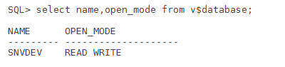
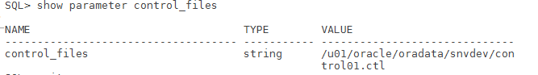
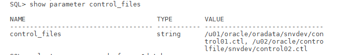

# Step by Step multiplexing Control File of Oracle Database

Step by Step multiplexing Control File of Oracle Database

In this post i will start with multiplexing Controlfile in oracle database.

Having multiple control files reduces the risk of control file loss due to corruption or accidental removal. In the case of corruption or loss recovery is no more difficult than copying the control file from another location.

Lets see the steps how to multiples the control file.

1.check the status of the database.

- 

2\) lish the controlfiles that are associated with database.

we see only one controlfile is used by the database sundev.

3)create new directroy to hold the controlfile at another location.

4\) shutdown the database and create the pfile from spfile

    $ mkdir -p /u02/oracle/controlfile/snvdev

    SQL> create spfile from pfile;
    File created.

    SQL> shut immediate
    Database closed.
    Database dismounted.
    ORACLE instance shut down.
    SQL> exit

5\) after bringing down the controlfile we need to copy /u01/oracle/oradata/snvdev/control01.ctl to /u02/oracle/controlfile/snvde

    cp /u01/oracle/oradata/snvdev/control01.ctl /u02/oracle/controlfile/snvdev/control02.ctl

6\) edit the pfile and add the entry of control02.ctl controlfile.

    *.control_files='/u01/oracle/oradata/snvdev/control01.ctl','/u02/oracle/controlfile/snvdev/control02.ctl'

7\) creating the spfile from pfile.

This step is very important because if you not created new spfile and started with old spfile then the versions of two controflies will be diffrent as control01.ctl is started and control02.ctl is not used and after also creating new spfile later on you will get below error.

    SQL> startup
    ORACLE instance started.

    Total System Global Area 1660944384 bytes
    Fixed Size 8621376 bytes
    Variable Size 1056965312 bytes
    Database Buffers 587202560 bytes
    Redo Buffers 8155136 bytes
    ORA-00214: control file '/u01/oracle/oradata/snvdev/control01.ctl' version 1597
    inconsistent with file '/u02/oracle/controlfile/snvdev/control02.ctl' version
    1584

    solution:
    i)shutdown the database.
    ii)recopy the controlfile from control01.ctl to control02.ctl
    iii) create spfile from pfile.
    iv) start the database.

8\) if the database is opened check the status of controlfile.

SQL\> show parameter control_files

- 

Thanks and hope this is helpful for new dba's.
