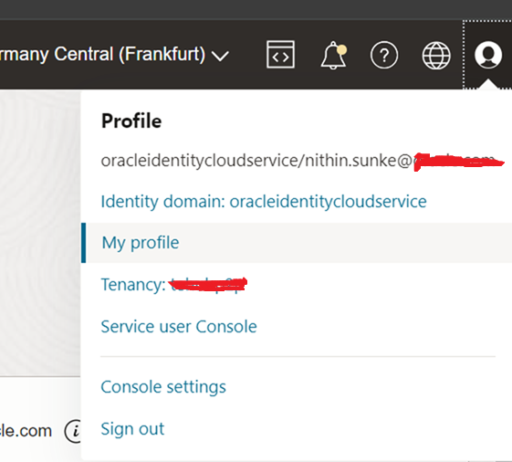
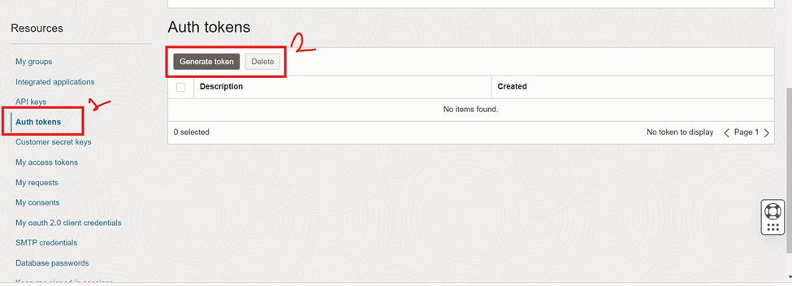
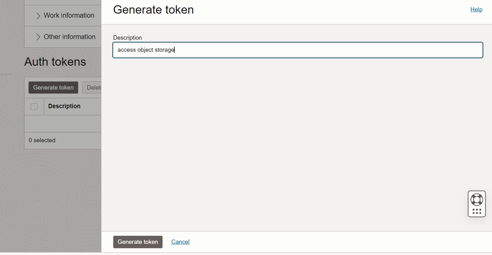
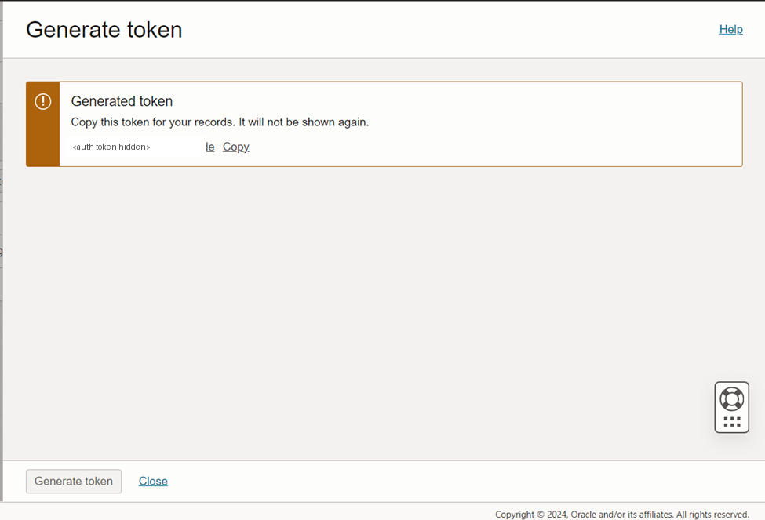
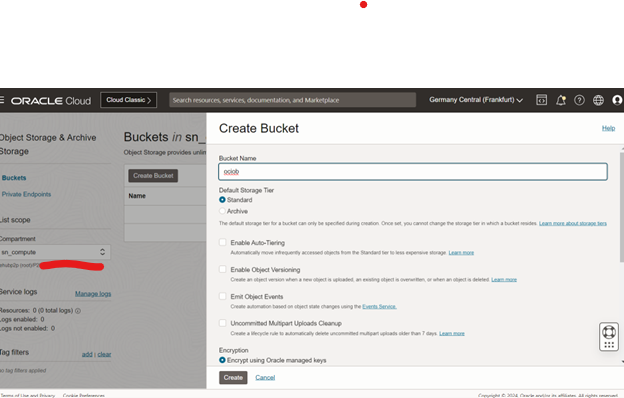
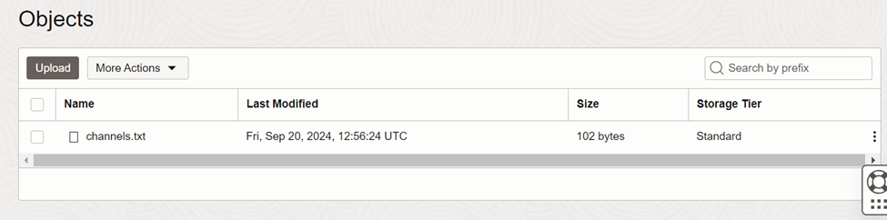
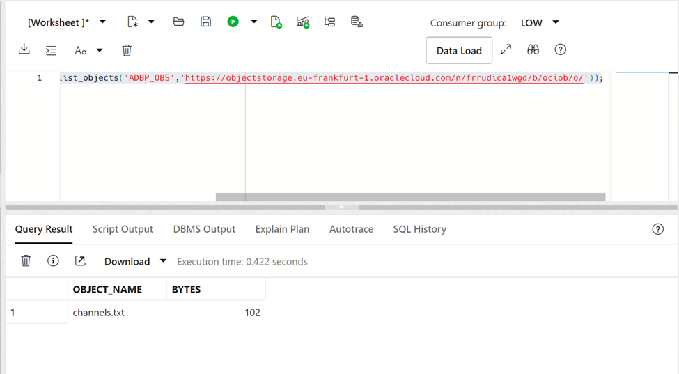
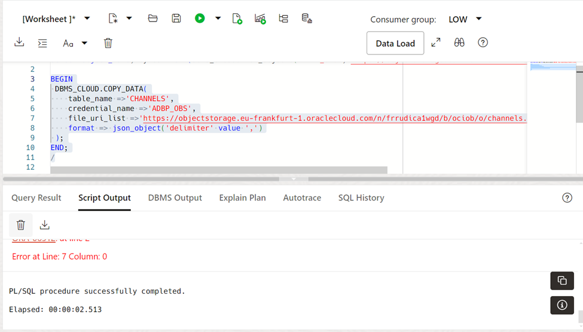
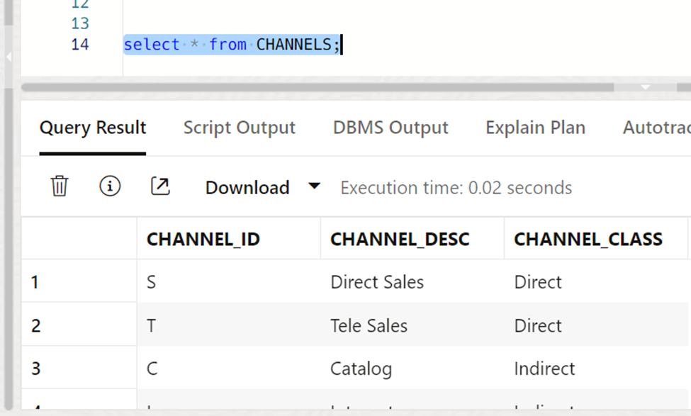

# Steps to access object storage from ADB

Oracle Cloud Infrastructure (OCI) provides **Object Storage** as a highly scalable and secure storage solution for unstructured data. One of the powerful capabilities of **Oracle Autonomous Database (ADB)** is its seamless integration with OCI Object Storage, which allows users to **load and unload data** directly from/to buckets.

In this blog post, we’ll walk through the steps to access and use Object Storage from an ADB instance.

## Prerequisites

Before you begin, ensure you have the following:

- An **Oracle Cloud Infrastructure (OCI)** account.
- A **bucket** created in **Object Storage**.
- An **Autonomous Database (ADB)** instance provisioned.
- A **user** with necessary permissions to manage and access buckets and ADB.
- A **wallet** downloaded for ADB access.

Step-by-Step Guide

### 1. Create a Bucket in Object Storage

1.  Go to the OCI Console.
2.  Navigate to **Storage \> Object Storage \> Buckets**.
3.  Choose your compartment and click **Create Bucket**.
4.  Provide a name, choose defaults (or adjust if needed), and create.

### 2. Upload Your File to the Bucket

1.  Go into the bucket you created.
2.  Click **Upload Object**.
3.  Choose your local file (e.g., `channels.txt`) and upload it.

### 3. Generate Auth Token for User in OCI

go to user profile and create a auth token









once it is generated it will display only one time keep it in other safe place.

### **4. Create Bucket & Identify Object Storage URL**



Once you have successfully generated Auth Token, **Create a Bucket** under Object Storage in OCI and Upload any Object inside that Bucket.



**Set Credentials In  Autonomous Database (ADB)**

Store your Cloud Object Storage credential using DBMS_CLOUD.CREATE_CREDENTIAL

create a new credentials:

``` wp-block-code
SET DEFINE OFF
BEGIN
  DBMS_CLOUD.CREATE_CREDENTIAL(
    credential_name => 'ADBP_OBS',
    username => 'oracleidentitycloudservice/<your-user@example.com>',
    password => '<auth-token>'
  );
END;
/
```

to view the credentails

``` wp-block-code
select * from DBA_CREDENTIALS;
```

## **Test Connection: ADW To Object Storage**

``` wp-block-code
select object_name, bytes from (dbms_cloud.list_objects('ADBP_OBS','https://objectstorage.eu-frankfurt-1.oraclecloud.com/n/<namespace>/b/ociob/o/'));
```



create a table to load the data from the text file.

``` wp-block-code
CREATE TABLE CHANNELS
   (channel_id CHAR(1),
    channel_desc VARCHAR2(20),
    channel_class VARCHAR2(20)
   );
/
```

load the data

``` wp-block-code
BEGIN
 DBMS_CLOUD.COPY_DATA(
    table_name =>'CHANNELS',
    credential_name =>'ADBP_OBS',
    file_uri_list =>'https://objectstorage.eu-frankfurt-1.oraclecloud.com/n/<namespace>/b/ociob/o/channels.txt',
    format => json_object('delimiter' value ',')
 );
END;
/
```



select the table


