# Steps to add a new table/tables to ongoing replication

In this blog post we will see how to add a table to ongoing replication using oracle goldgengate 21c

### Assumptions:

1.  There is a running Goldengate instance.
2.  Already on-going replication is  configured.

Table used for replication is **customers**.

At source

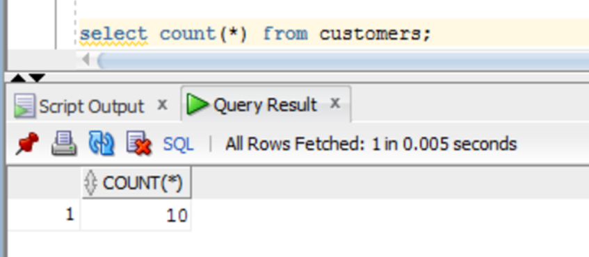

Now add  the table customers into ongoing replication.

On  extract:

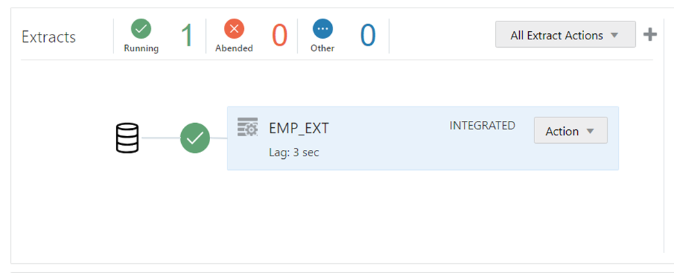

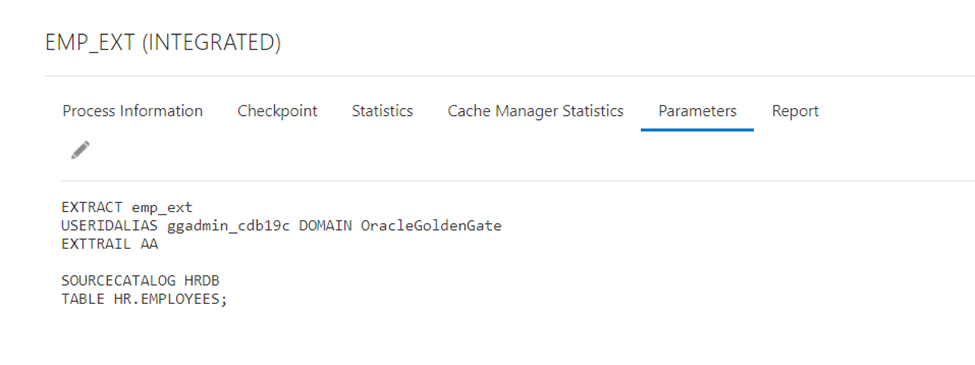

Added table to extract

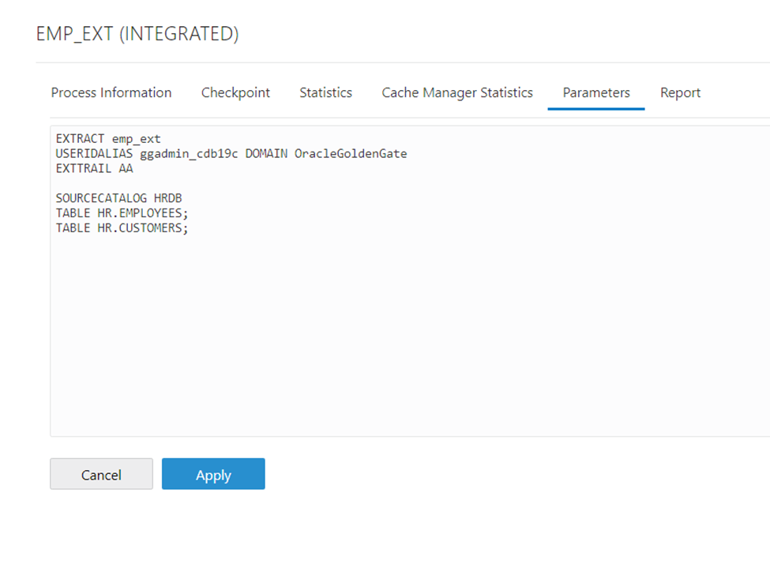

Restart the extract and inserted few more rows in the source table.

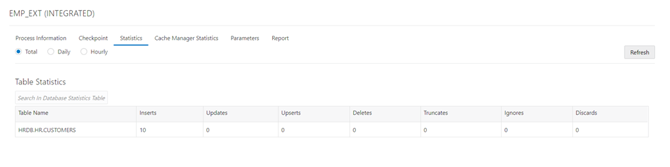

Create the extract to load the initial data.

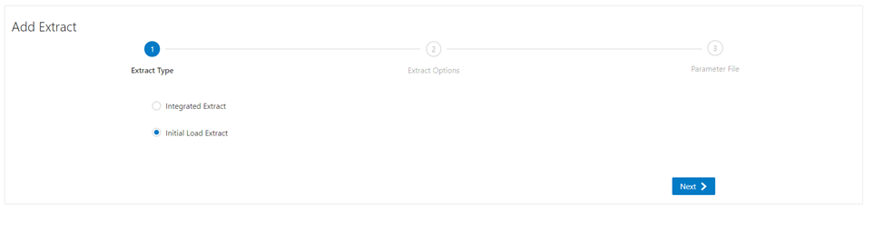

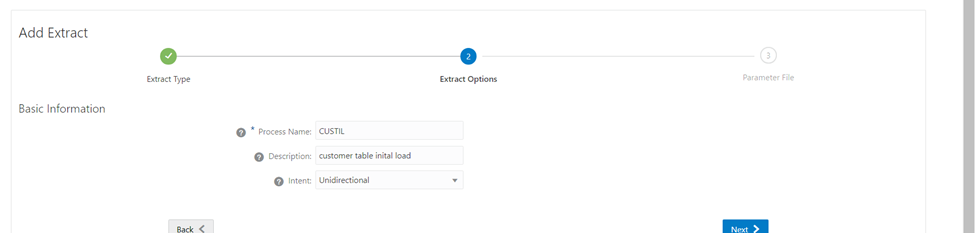

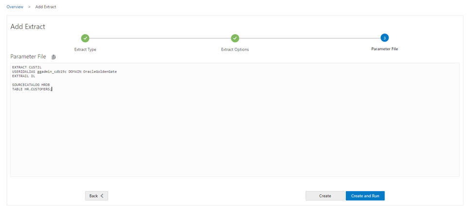

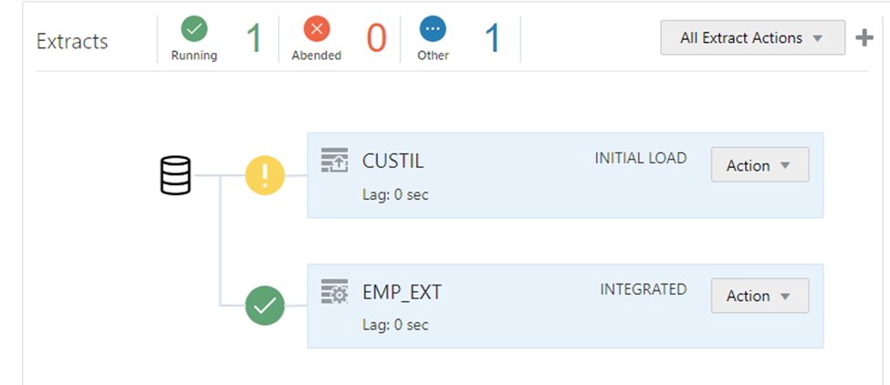

Start the initial load extract

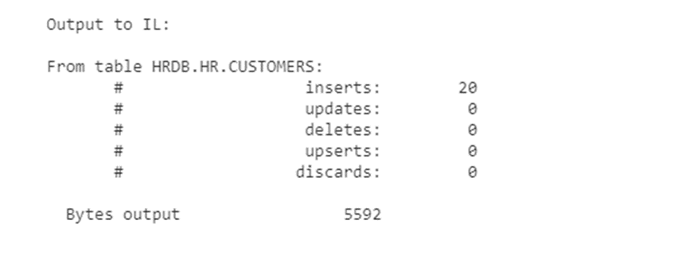

Create initial load replicate

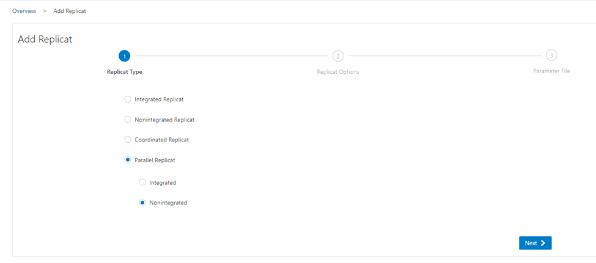

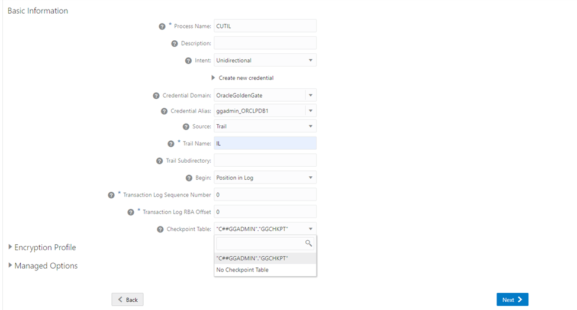

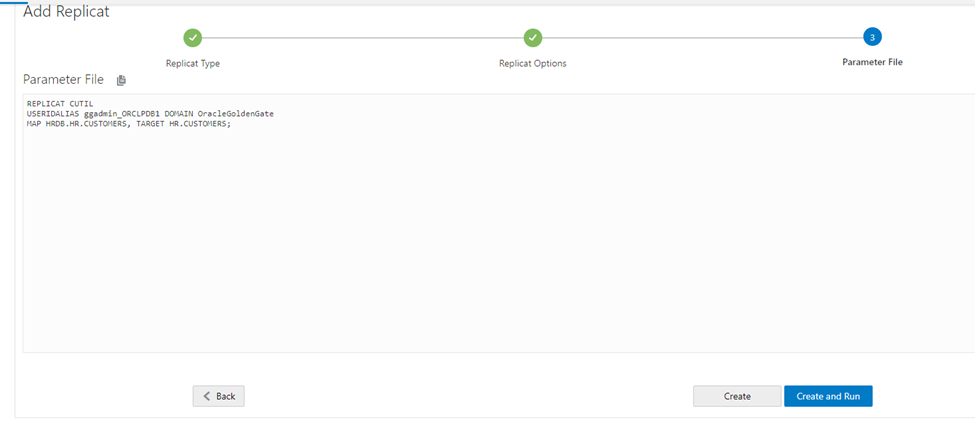

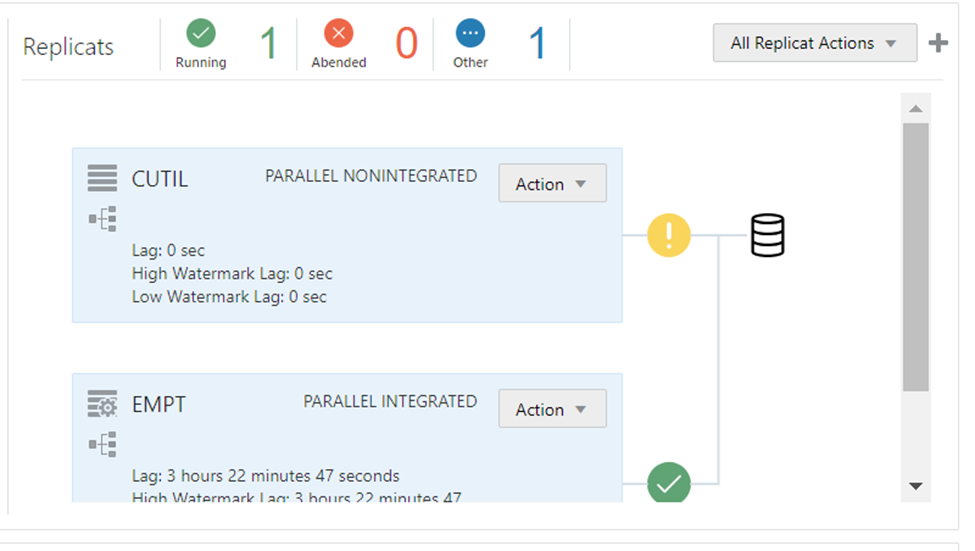

Create the empty table on target.

``` wp-block-code
CREATE TABLE CUSTOMERS (
    CUSTOMER_ID NUMBER GENERATED BY DEFAULT AS IDENTITY,
    FIRST_NAME VARCHAR2(50),
    LAST_NAME VARCHAR2(50) NOT NULL,
    EMAIL VARCHAR2(100) UNIQUE NOT NULL,
    PHONE_NUMBER VARCHAR2(15),
    ADDRESS VARCHAR2(200),
    CITY VARCHAR2(100),
    STATE VARCHAR2(50),
    ZIP_CODE VARCHAR2(20),
    CREATED_AT DATE DEFAULT SYSDATE,
    PRIMARY KEY (CUSTOMER_ID)
);
```

Now start the initial replicate

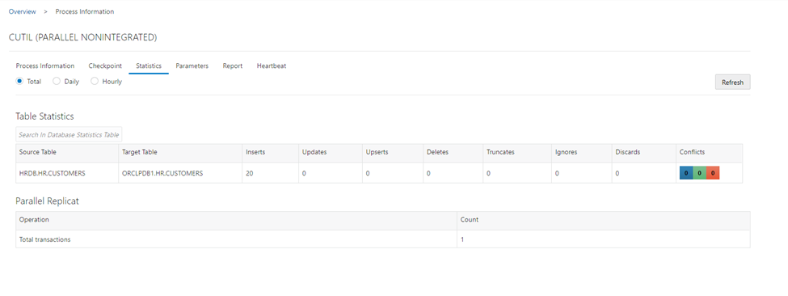

Once all rows are replicated stop the initial load repliact.

Add the table into on-going replicate

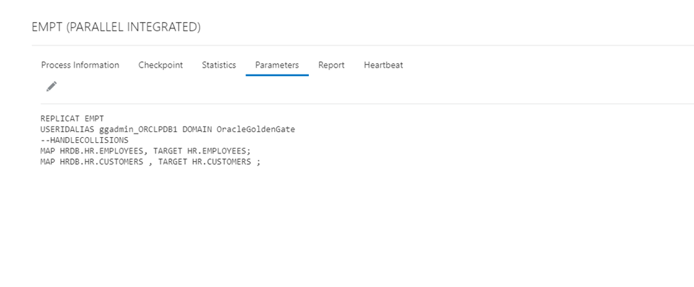

Now start the on-going  replication

Validate the count of row in tables.

On source database.

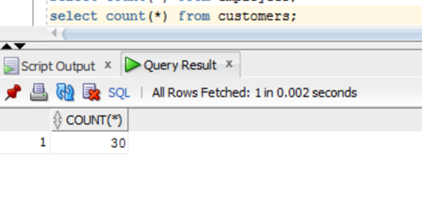

On target database.

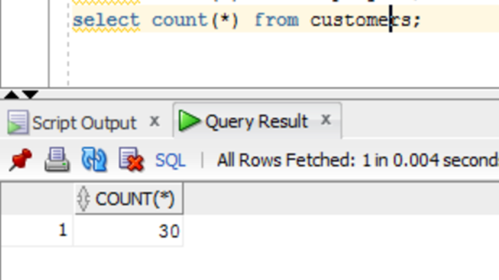
