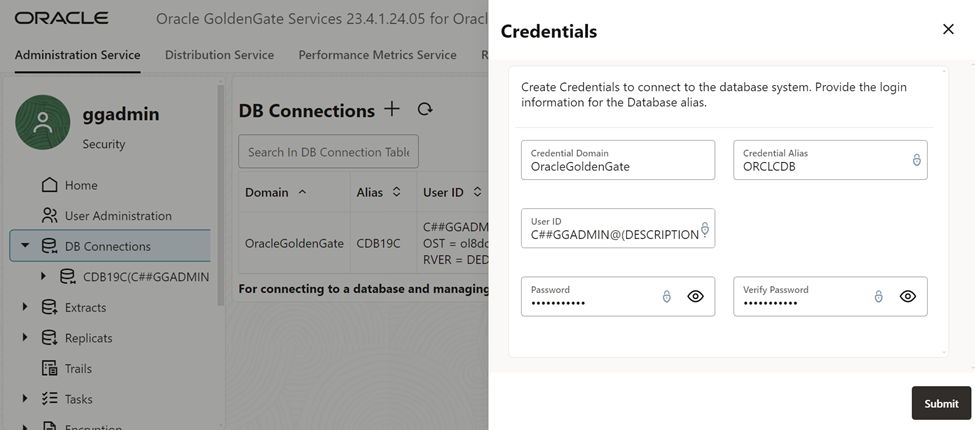
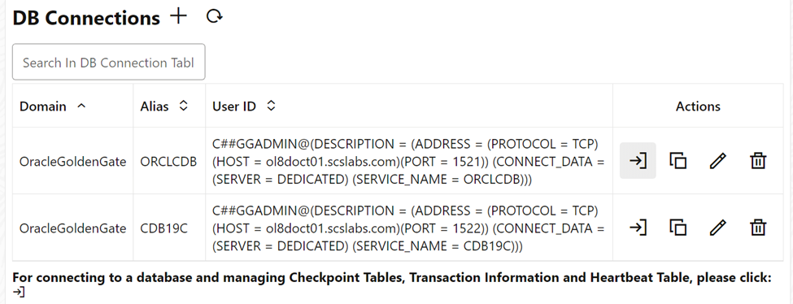
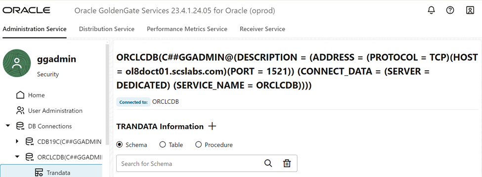
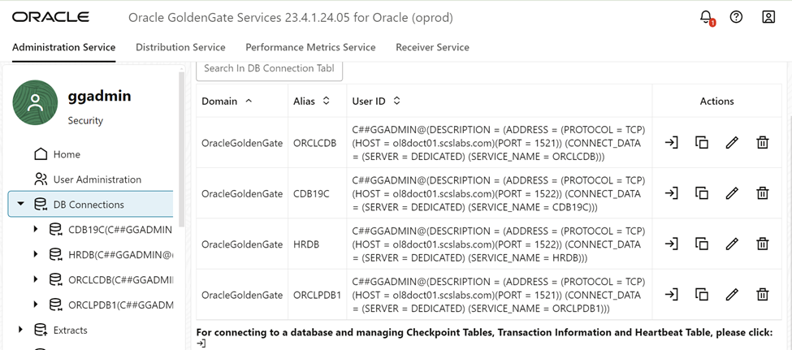
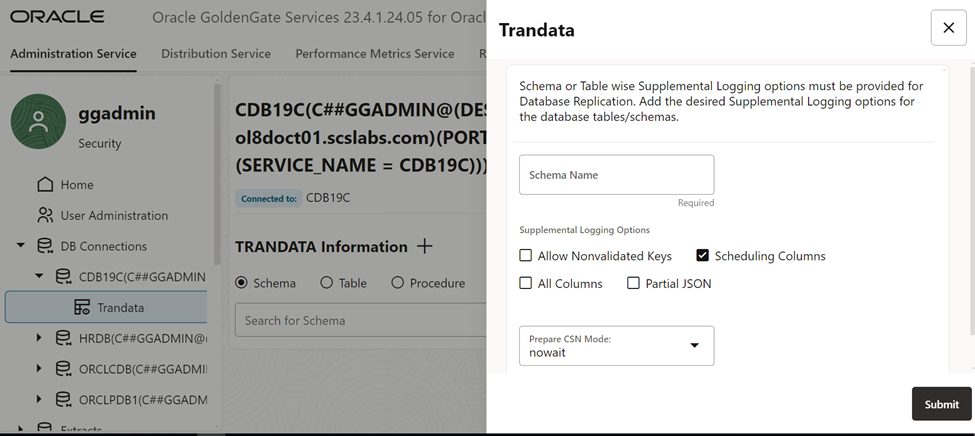
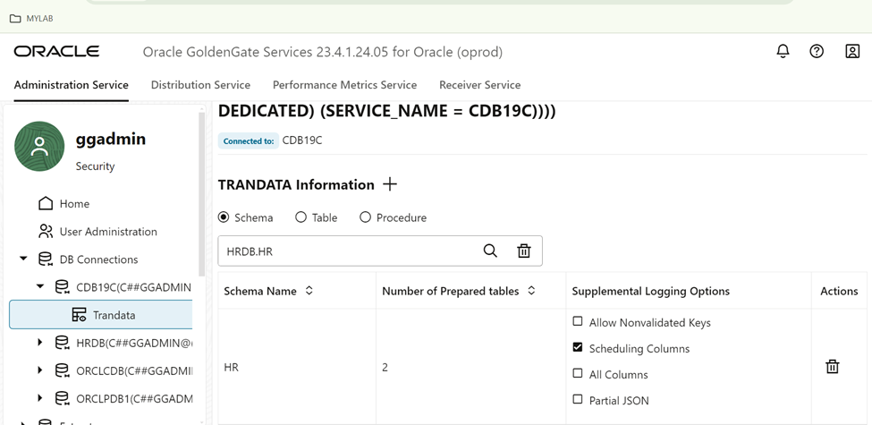

# steps to add database connections to goldengate 23ai.

This steps to add database connections to oracle goldengate 23ai.

login into adminserver console

go to db connection tab

From the actions column select connect to database icon

If the credentials and connection string is correct it will login into database show below screen

add the schema trandata

