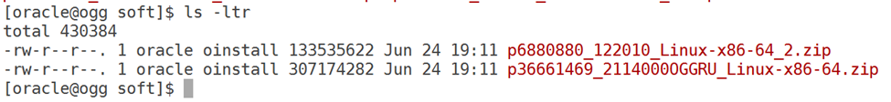
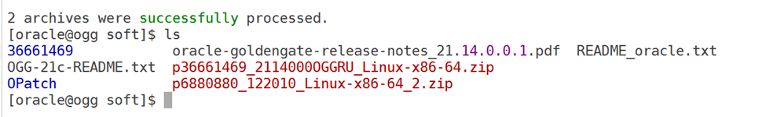
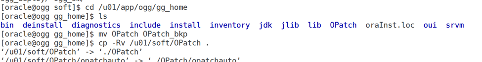
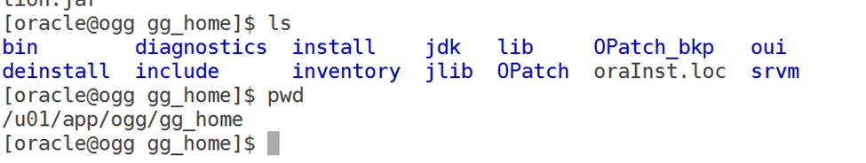
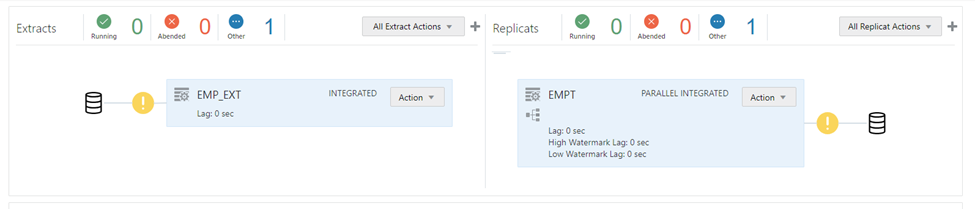
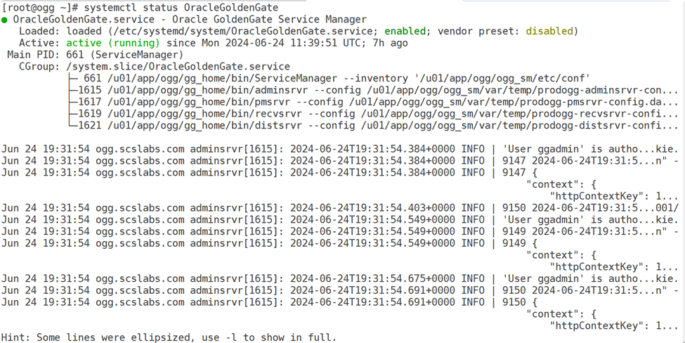
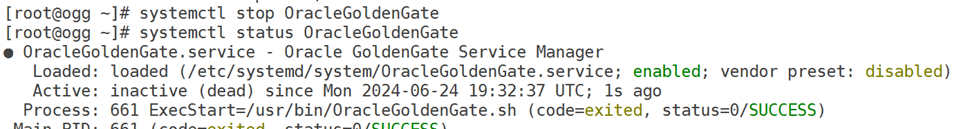
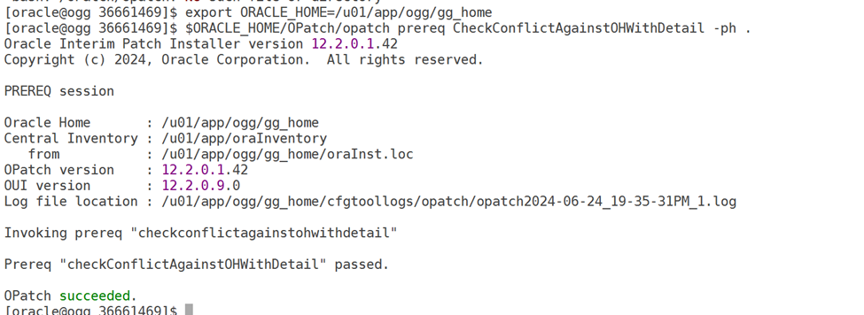
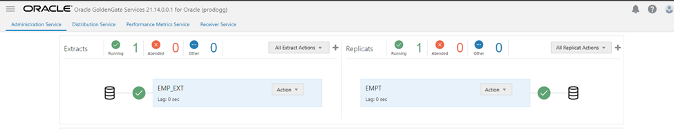

# steps to apply the patch on oracle Goldengate 21c

This blog provides steps to apply the patch on oracle Goldengate 21c.

Current version: 21.3.0.0.0


Copy the patch files to server



Stop the Goldengate replication

Order of stopping the replication

- Stop replicat
- Stop receiver path/ distribution path
- Stop the extract

unzip the patch files



update opatch utility





Stop the process



Stop the Goldengate service demon as root user





check the patch conflicts

\$ORACLE_HOME/OPatch/opatch prereq CheckConflictAgainstOHWithDetail -ph .



apply the patch

``` wp-block-code
[oracle@ogg 36661469]$ $ORACLE_HOME/OPatch/opatch apply
Oracle Interim Patch Installer version 12.2.0.1.42
Copyright (c) 2024, Oracle Corporation.  All rights reserved.

Oracle Home       : /u01/app/ogg/gg_home
Central Inventory : /u01/app/oraInventory
   from           : /u01/app/ogg/gg_home/oraInst.loc
OPatch version    : 12.2.0.1.42
OUI version       : 12.2.0.9.0
Log file location : /u01/app/ogg/gg_home/cfgtoollogs/opatch/opatch2024-06-24_19-39-39PM_1.log

Verifying environment and performing prerequisite checks...
OPatch continues with these patches:   36661469

Do you want to proceed? [y|n]
y
User Responded with: Y
All checks passed.

Please shutdown Oracle instances running out of this ORACLE_HOME on the local system.
(Oracle Home = '/u01/app/ogg/gg_home')

Is the local system ready for patching? [y|n]
y
User Responded with: Y
Backing up files...
Applying interim patch '36661469' to OH '/u01/app/ogg/gg_home'

Patching component oracle.oggcore.services.ora21c, 21.1.0.0.0...
Patch 36661469 successfully applied.
Log file location: /u01/app/ogg/gg_home/cfgtoollogs/opatch/opatch2024-06-24_19-39-39PM_1.log

OPatch succeeded.
[oracle@ogg 36661469]$
```

start all the process

``` wp-block-code
[root@ogg ~]# systemctl start OracleGoldenGate
[root@ogg ~]# systemctl status OracleGoldenGate
● OracleGoldenGate.service - Oracle GoldenGate Service Manager
   Loaded: loaded (/etc/systemd/system/OracleGoldenGate.service; enabled; vendor preset: disabled)
   Active: active (running) since Mon 2024-06-24 19:41:49 UTC; 5s ago
 Main PID: 3175 (ServiceManager)
   CGroup: /system.slice/OracleGoldenGate.service
           ├─3175 /u01/app/ogg/gg_home/bin/ServiceManager --inventory '/u01/app/ogg/ogg_sm/etc/conf'
           ├─3219 /u01/app/ogg/gg_home/bin/adminsrvr --config /u01/app/ogg/ogg_sm/var/temp/prodogg-adminsrvr-config.dat --force -...
           ├─3221 /u01/app/ogg/gg_home/bin/pmsrvr --config /u01/app/ogg/ogg_sm/var/temp/prodogg-pmsrvr-config.dat --force --quiet...
           ├─3223 /u01/app/ogg/gg_home/bin/recvsrvr --config /u01/app/ogg/ogg_sm/var/temp/prodogg-recvsrvr-config.dat --force --q...
           └─3225 /u01/app/ogg/gg_home/bin/distsrvr --config /u01/app/ogg/ogg_sm/var/temp/prodogg-distsrvr-config.dat --force --q...

Jun 24 19:41:53 ogg.scslabs.com distsrvr[3225]: 2024-06-24T19:41:53.222+0000 INFO | Configuring user authorization enabled.
Jun 24 19:41:53 ogg.scslabs.com recvsrvr[3223]: 2024-06-24T19:41:53.240+0000 INFO | Configuring user authorization enabled.
Jun 24 19:41:53 ogg.scslabs.com adminsrvr[3219]: 2024-06-24T19:41:53.273+0000 INFO | Configuring user authorization secure ...tore'.
Jun 24 19:41:53 ogg.scslabs.com adminsrvr[3219]: 2024-06-24T19:41:53.288+0000 INFO | Configuring user session simple store ....dat'.
Jun 24 19:41:53 ogg.scslabs.com pmsrvr[3221]: 2024-06-24T19:41:53.312+0000 INFO | Configuring user authorization secure sto...tore'.
Jun 24 19:41:53 ogg.scslabs.com pmsrvr[3221]: 2024-06-24T19:41:53.312+0000 INFO | Configuring user session simple store pat....dat'.
Jun 24 19:41:53 ogg.scslabs.com distsrvr[3225]: 2024-06-24T19:41:53.419+0000 INFO | Configuring user authorization secure s...tore'.
Jun 24 19:41:53 ogg.scslabs.com distsrvr[3225]: 2024-06-24T19:41:53.419+0000 INFO | Configuring user session simple store p....dat'.
Jun 24 19:41:53 ogg.scslabs.com recvsrvr[3223]: 2024-06-24T19:41:53.430+0000 INFO | Configuring user authorization secure s...tore'.
Jun 24 19:41:53 ogg.scslabs.com recvsrvr[3223]: 2024-06-24T19:41:53.451+0000 INFO | Configuring user session simple store p....dat'.
Hint: Some lines were ellipsized, use -l to show in full.
```

``` wp-block-code
[oracle@ogg bin]$ ./adminclient
Oracle GoldenGate Administration Client for Oracle
Version 21.14.0.0.1 OGGCORE_21.14.0.0.0OGGRU_PLATFORMS_240525.0856

Copyright (C) 1995, 2024, Oracle and/or its affiliates. All rights reserved.

Oracle Linux 7, x64, 64bit (optimized) on May 25 2024 10:27:58
Operating system character set identified as UTF-8.

OGG (not connected) 2> connect http://192.168.1.11:7001 user ggadmin password xxxxxx

OGG (http://192.168.1.11:7001 prodogg) 3> info all
Program     Status      Group       Type             Lag at Chkpt  Time Since Chkpt

EXTRACT     STOPPED     EMP_EXT     INTEGRATED       00:00:00      00:15:26
REPLICAT    STOPPED     EMPT        PARALLEL INT     00:00:00      00:16:16

OGG (http://192.168.1.11:7001 prodogg) 4> start extract EMP_EXT
2024-06-24T19:46:46Z  INFO    OGG-00975  Extract group EMP_EXT starting.
2024-06-24T19:46:46Z  INFO    OGG-15426  Extract group EMP_EXT started.

OGG (http://192.168.1.11:7001 prodogg) 5> info all
Program     Status      Group       Type             Lag at Chkpt  Time Since Chkpt

EXTRACT     RUNNING     EMP_EXT     INTEGRATED       00:00:00      00:00:10
REPLICAT    STOPPED     EMPT        PARALLEL INT     00:00:00      00:16:49

OGG (http://192.168.1.11:7001 prodogg) 6> start replicat EMPT
2024-06-24T19:47:11Z  INFO    OGG-00975  Replicat group EMPT starting.
2024-06-24T19:47:11Z  INFO    OGG-15445  Replicat group EMPT started.

OGG (http://192.168.1.11:7001 prodogg) 7> info all
Program     Status      Group       Type             Lag at Chkpt  Time Since Chkpt

EXTRACT     RUNNING     EMP_EXT     INTEGRATED       00:00:00      00:00:00
REPLICAT    RUNNING     EMPT        PARALLEL INT     00:00:00      00:17:02

OGG (http://192.168.1.11:7001 prodogg) 8>
```


