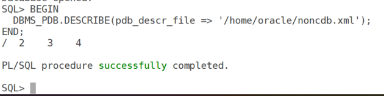
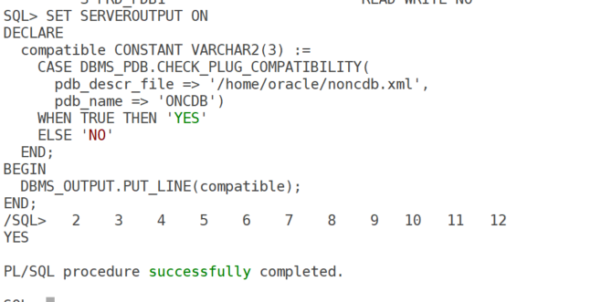
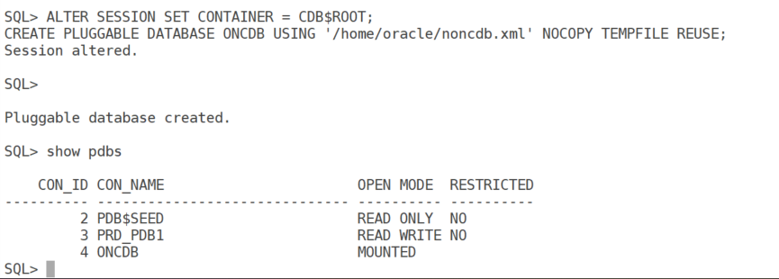
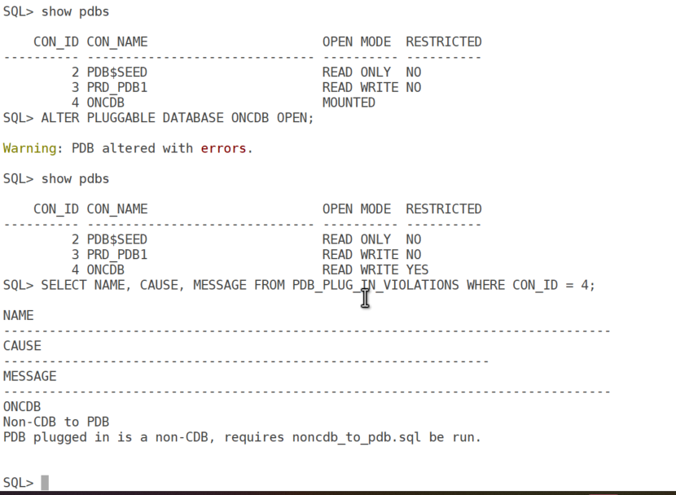
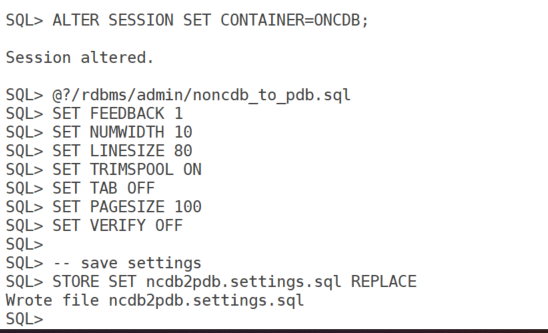
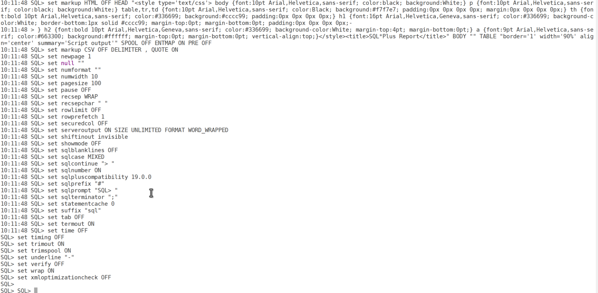
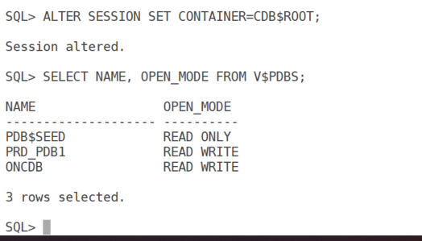

# Convert Non-CDB to PDB in Oracle 19c: A Step-by-Step Guide

## Introduction

In the ever-evolving world of Oracle Database administration, transitioning from a non-Container Database (non-CDB) to a Pluggable Database (PDB) architecture is a common requirement. This shift allows for better resource management, easier patching, and multitenancy benefits in Oracle Database 19c. If you're running a non-CDB and want to convert it to a PDB using the DBMS_PDB method while keeping downtime to a minimum, you're in the right place.

The DBMS_PDB package provides a straightforward way to describe, check compatibility, and plug in your non-CDB as a PDB into a Container Database (CDB). The key to low downtime is performing most preparations while the database is still operational, only shutting it down for the final plug-in step. In this blog post, I'll walk you through the detailed steps, prerequisites, and best practices to achieve this conversion efficiently.

**Note**: Always test this process in a non-production environment first!

## Prerequisites

Before diving into the conversion, ensure the following are in place:

- **Oracle Database Version**: Your non-CDB must be Oracle Database 12c Release 1 (12.1.0.2) or later. We're focusing on 19c here.
- **Target CDB**: You'll need an existing CDB at the same version and patch level as your non-CDB. It must be compatible in terms of endianness, character set, and options.
- **Privileges**: SYSDBA access on both the non-CDB and CDB.
- **Storage and Backups**: Sufficient disk space for any potential file copies (though we'll use NOCOPY to avoid this where possible). Take a full backup of your non-CDB before starting.
- **Downtime Strategy**: The process minimizes downtime by generating metadata in read-only mode (brief interruption) and allowing the database to resume read-write operations during preparations.

If your CDB doesn't exist yet, create one using the Database Configuration Assistant (DBCA) or manually.

### Step-by-Step Conversion Process

#### Step 1: Prepare the Non-CDB for Conversion

Ensure your non-CDB is transactionally consistent—no ongoing DDL operations that could affect structure.

To generate the XML metadata file with minimal impact:

1.  Shut down the non-CDB:

``` wp-block-code
sqlplus / as sysdba
SHUTDOWN IMMEDIATE;
```

2\. Restart in read-only mode (this allows queries but prevents writes—brief downtime):

``` wp-block-code
STARTUP OPEN READ ONLY;
```

This read-only phase is quick and only needed for the next step.

#### Step 2: Generate the XML Metadata File

While in read-only mode, connect as SYSDBA and use DBMS_PDB.DESCRIBE to create an XML file describing the non-CDB:

``` wp-block-code
sqlplus / as sysdba
BEGIN
  DBMS_PDB.DESCRIBE(pdb_descr_file => '/home/oracle/noncdb.xml');
END;
/
```



This operation is fast (seconds) and captures all necessary metadata like datafiles, tablespaces, and users.

#### Step 3: Verify Compatibility with the Target CDB

Switch to the CDB and check if the non-CDB can be plugged in:

``` wp-block-code
sqlplus / as sysdba
ALTER SESSION SET CONTAINER = CDB$ROOT;
```

Run the compatibility check:

``` wp-block-code
SET SERVEROUTPUT ON
DECLARE
  compatible CONSTANT VARCHAR2(3) := 
    CASE DBMS_PDB.CHECK_PLUG_COMPATIBILITY(
      pdb_descr_file => '/home/oracle/noncdb.xml',
      pdb_name => 'ONCDB')
    WHEN TRUE THEN 'YES'
    ELSE 'NO'
  END;
BEGIN
  DBMS_OUTPUT.PUT_LINE(compatible);
END;
/
```



If it returns 'NO', investigate violations:

``` wp-block-code
SELECT NAME, CAUSE, MESSAGE FROM PDB_PLUG_IN_VIOLATIONS WHERE NAME = 'ONCDB';
```

Common issues include parameter mismatches (e.g., COMPATIBLE) or missing database options. Resolve them by adjusting init parameters in the non-CDB or CDB, then re-run the check.

#### Step 4: Plug the Non-CDB into the CDB as a PDB

``` wp-block-code
sqlplus / as sysdba
ALTER SESSION SET CONTAINER = CDB$ROOT;
CREATE PLUGGABLE DATABASE ONCDB USING '/home/oracle/noncdb.xml' NOCOPY TEMPFILE REUSE;
```



**Handle Errors**

- If you encounter ORA-65139: Mismatch between XML metadata file and data file:
  - Ensure the non-CDB was in READ ONLY mode when generating the XML file.
  - Verify data file SCNs:`SELECT FILE#, NAME, CHECKPOINT_CHANGE# FROM V$DATAFILE_HEADER;`
  - Compare with the XML file’s \<fcpsb\> values in /home/oracle/noncdb.xml.
  - Regenerate the XML file if necessary.

#### Step 5: **Open the PDB**



The PDB will be opened in Restricted mode. This is expected as we are not ran noncdb_to_pdb.sql which will update the metadata on non-cdb with pdb.

#### Step 6 : Finalize the PDB Conversion

**Run Non-CDB to PDB Conversion Script**

``` wp-block-code
@?/rdbms/admin/noncdb_to_pdb.sql
```





**Verify PDB Status**

Check the PDB’s status:

``` wp-block-code
ALTER SESSION SET CONTAINER=CDB$ROOT;
SELECT NAME, OPEN_MODE FROM V$PDBS;
```



#### Step 7: Post-Conversion Tasks

**Update TNS Configuration**

Add a TNS entry for the PDB in `$ORACLE_HOME/network/admin/tnsnames.ora`

``` wp-block-code
ONCDB =
  (DESCRIPTION =
    (ADDRESS = (PROTOCOL = TCP)(HOST = <hostname>)(PORT = 1521))
    (CONNECT_DATA =
      (SERVER = DEDICATED)
      (SERVICE_NAME = ONCDB)
    )
  )
```

**Backup the CDB and PDB**

Perform a full backup using RMAN:

``` wp-block-code
rman target /
BACKUP DATABASE;
```

#### Step 8: **Drop the Original Non-CDB (Optional)**

Drop the non-CDB after verifying the PDB, if no longer needed.

### Pros and Cons of Converting Non-CDB to PDB

### Pros

- **Centralized Management**: Manage multiple PDBs within a single CDB, reducing administrative overhead.
- **Resource Efficiency**: Share resources (memory, CPU) across PDBs, optimizing hardware usage.
- **Simplified Upgrades**: Upgrade one CDB to apply changes to all PDBs, streamlining maintenance.
- **Scalability**: Easily plug/unplug PDBs for migration or consolidation.
- **Backup and Recovery**: Centralized backups for all PDBs within the CDB.

### Cons

- **Initial Effort**: Conversion requires careful planning, compatibility checks, and testing.
- **Resource Contention**: PDBs share CDB resources, which may lead to performance issues if not managed properly.
- **Downtime**: Conversion may require downtime for the non-CDB during the process.

## Use Cases

1.  **Database Consolidation**: Combine multiple non-CDBs into a single CDB to reduce hardware and licensing costs.
2.  **Modernization**: Transition legacy non-CDBs to the multitenant architecture to leverage Oracle 19c features.
3.  **Dev/Test Environments**: Create lightweight PDBs from non-CDBs for development or testing without duplicating resources.
4.  **Migration**: Move non-CDBs to a CDB in a different environment (e.g., cloud or new server) with minimal changes.

## Best Practices

1.  **Backup Before Conversion**
    - Always take a full backup of the non-CDB and CDB before starting the conversion process.
2.  **Validate Compatibility**
    - Use `DBMS_PDB.CHECK_PLUG_COMPATIBILITY` to identify and resolve issues early.
3.  **Use READ ONLY Mode**
    - Generate the XML file while the non-CDB is in `READ ONLY` mode to ensure data consistency.
4.  **Test in a Non-Production Environment**
    - Perform the conversion in a test environment first to validate the process and identify potential issues.
5.  **Monitor SCN Consistency**
    - Check data file SCNs to avoid `ORA-65139` errors. Regenerate the XML file if discrepancies are found.
6.  **Use FILE_NAME_CONVERT**
    - Specify `FILE_NAME_CONVERT` to handle different directory structures when copying data files.
7.  **Automate with Scripts**
    - Create reusable scripts to streamline the process for multiple non-CDBs.
8.  **Monitor Post-Conversion**
    - Verify data integrity, performance, and accessibility after conversion.
9.  **Document the Process**
    - Maintain detailed documentation of paths, parameters, and steps for future reference.
10. **Plan for Downtime**
    - Schedule the conversion during a maintenance window to minimize impact on users.

## Troubleshooting Common Issues

- **ORA-65139: Mismatch between XML metadata file and data file**
  - Ensure the non-CDB was in `READ ONLY` mode during XML generation.
  - Verify data file SCNs match the XML file’s `<fcpsb>` values.
  - Regenerate the XML file if necessary.
- **File Path Issues**
  - Use `FILE_NAME_CONVERT` to map old paths to new ones.
- **Permission Errors**
  - Ensure the Oracle user has read/write permissions for the XML file and data directories:`chmod 660 /home/oracle/noncdb.xml chown oracle:oinstall /home/oracle/noncdb.xml`
- **Compatibility Violations**
  - Check `PDB_PLUG_IN_VIOLATIONS` and resolve issues (e.g., install missing components).

## Conclusion

Converting a non-CDB to a PDB in Oracle 19c is a powerful way to modernize your database infrastructure, enabling centralized management and resource efficiency. By following the steps outlined above, using the `DBMS_PDB` package, and adhering to best practices, you can ensure a smooth transition. Always test the process in a non-production environment and maintain backups to mitigate risks.
