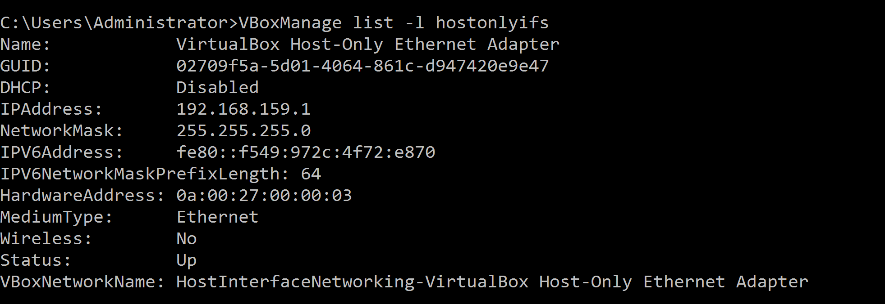
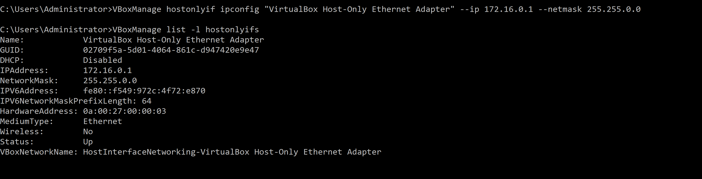
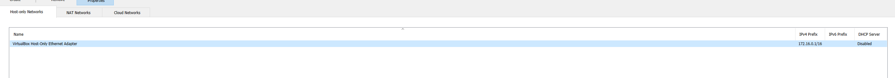

# steps to create hostonly network in oracle virtual box from command line in windows

Below are the steps to create host only network from command line on windows servers

1.  to create a hostonly network

VBoxManage hostonlyif create

2\. list the available hostonly networks on host

VBoxManage list -l hostonlyifs

3\. Modify the values as required

VBoxManage hostonlyif ipconfig "VirtualBox Host-Only Ethernet Adapter" --ip 172.16.0.1 --netmask 255.255.0.0

