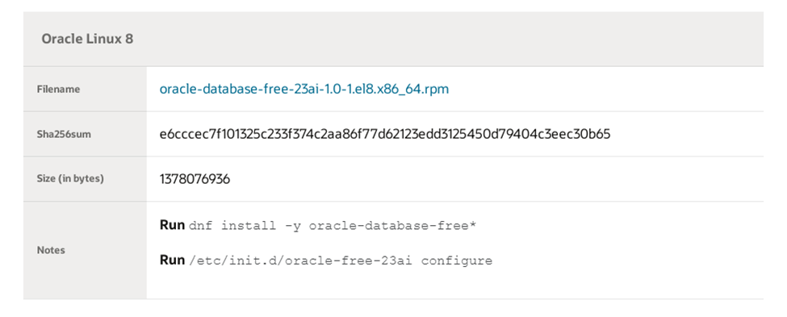
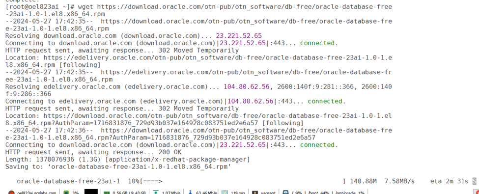

# Steps to install oracle database 23ai free

In this blog post we will see how to install oracle database 23ai free in oel8

## Assumptions:

- Installed oel8 operating system.
- Update the os to latest version.

Download oel8 23ai database rpm from <https://www.oracle.com/database/free/get-started/>





First time when I was installed it got failed with below error

``` wp-block-code
[root@oel823ai ~]# dnf install -y oracle-database-free*
Last metadata expiration check: 3:20:33 ago on Mon 27 May 2024 02:26:52 PM UTC.
Dependencies resolved.
===========================================================================================================================
 Package                               Architecture Version                                  Repository               Size
===========================================================================================================================
Installing:
 oracle-database-free-23ai             x86_64       1.0-1                                    @commandline            1.3 G
Installing dependencies:
 bind-libs                             x86_64       32:9.11.36-11.el8_9.1                    ol8_appstream           175 k
 bind-libs-lite                        x86_64       32:9.11.36-11.el8_9.1                    ol8_appstream           1.2 M
 bind-license                          noarch       32:9.11.36-11.el8_9.1                    ol8_appstream           103 k
 bind-utils                            x86_64       32:9.11.36-11.el8_9.1                    ol8_appstream           452 k
 compat-openssl10                      x86_64       1:1.0.2o-4.el8_6                         ol8_appstream           1.1 M
 dejavu-fonts-common                   noarch       2.35-7.el8                               ol8_baseos_latest        74 k
 dejavu-sans-fonts                     noarch       2.35-7.el8                               ol8_baseos_latest       1.5 M
 fontconfig                            x86_64       2.13.1-4.el8                             ol8_baseos_latest       274 k
 fontpackages-filesystem               noarch       1.44-22.el8                              ol8_baseos_latest        16 k
 fstrm                                 x86_64       0.6.1-3.el8                              ol8_appstream            29 k
 ksh                                   x86_64       20120801-259.0.1.el8                     ol8_appstream           923 k
 libX11-xcb                            x86_64       1.6.8-6.el8                              ol8_appstream            14 k
 libXcomposite                         x86_64       0.4.4-14.el8                             ol8_appstream            28 k
 libXi                                 x86_64       1.7.10-1.el8                             ol8_appstream            49 k
 libXinerama                           x86_64       1.1.4-1.el8                              ol8_appstream            15 k
 libXrandr                             x86_64       1.5.2-1.el8                              ol8_appstream            34 k
 libXrender                            x86_64       0.9.10-7.el8                             ol8_appstream            33 k
 libXtst                               x86_64       1.2.3-7.el8                              ol8_appstream            22 k
 libXv                                 x86_64       1.0.11-7.el8                             ol8_appstream            20 k
 libXxf86dga                           x86_64       1.1.5-1.el8                              ol8_appstream            26 k
 libXxf86misc                          x86_64       1.0.4-1.el8                              ol8_appstream            23 k
 libXxf86vm                            x86_64       1.1.4-9.el8                              ol8_appstream            19 k
 libdmx                                x86_64       1.1.4-3.el8                              ol8_appstream            22 k
 lm_sensors-libs                       x86_64       3.4.0-23.20180522git70f7e08.el8          ol8_baseos_latest        59 k
 oracle-database-preinstall-23ai       x86_64       1.0-2.el8                                ol8_appstream            30 k
 protobuf-c                            x86_64       1.3.0-8.el8                              ol8_appstream            37 k
 python3-bind                          noarch       32:9.11.36-11.el8_9.1                    ol8_appstream           151 k
 smartmontools                         x86_64       1:7.1-2.el8                              ol8_baseos_latest       553 k
 sysstat                               x86_64       11.7.3-11.0.1.el8                        ol8_appstream           427 k
 xorg-x11-utils                        x86_64       7.5-28.el8                               ol8_appstream           136 k
 xorg-x11-xauth                        x86_64       1:1.0.9-12.el8                           ol8_appstream            39 k

Transaction Summary
===========================================================================================================================
Install  32 Packages

Total size: 1.3 G
Total download size: 7.5 M
Installed size: 3.6 G
Downloading Packages:
(1/31): dejavu-sans-fonts-2.35-7.el8.noarch.rpm                                            2.8 MB/s | 1.5 MB     00:00
(2/31): fontpackages-filesystem-1.44-22.el8.noarch.rpm                                     687 kB/s |  16 kB     00:00
(3/31): lm_sensors-libs-3.4.0-23.20180522git70f7e08.el8.x86_64.rpm                         1.7 MB/s |  59 kB     00:00
(4/31): smartmontools-7.1-2.el8.x86_64.rpm                                                 4.0 MB/s | 553 kB     00:00
(5/31): bind-libs-9.11.36-11.el8_9.1.x86_64.rpm                                            3.4 MB/s | 175 kB     00:00
(6/31): bind-libs-lite-9.11.36-11.el8_9.1.x86_64.rpm                                       4.7 MB/s | 1.2 MB     00:00
(7/31): bind-license-9.11.36-11.el8_9.1.noarch.rpm                                         2.4 MB/s | 103 kB     00:00
(8/31): bind-utils-9.11.36-11.el8_9.1.x86_64.rpm                                           4.8 MB/s | 452 kB     00:00
(9/31): compat-openssl10-1.0.2o-4.el8_6.x86_64.rpm                                         5.3 MB/s | 1.1 MB     00:00
(10/31): fstrm-0.6.1-3.el8.x86_64.rpm                                                      1.3 MB/s |  29 kB     00:00
(11/31): dejavu-fonts-common-2.35-7.el8.noarch.rpm                                          53 kB/s |  74 kB     00:01
(12/31): libX11-xcb-1.6.8-6.el8.x86_64.rpm                                                 658 kB/s |  14 kB     00:00
(13/31): libXcomposite-0.4.4-14.el8.x86_64.rpm                                             641 kB/s |  28 kB     00:00
(14/31): libXi-1.7.10-1.el8.x86_64.rpm                                                     1.2 MB/s |  49 kB     00:00
(15/31): libXinerama-1.1.4-1.el8.x86_64.rpm                                                322 kB/s |  15 kB     00:00
(16/31): ksh-20120801-259.0.1.el8.x86_64.rpm                                               4.4 MB/s | 923 kB     00:00
(17/31): libXrandr-1.5.2-1.el8.x86_64.rpm                                                  705 kB/s |  34 kB     00:00
(18/31): libXrender-0.9.10-7.el8.x86_64.rpm                                                683 kB/s |  33 kB     00:00
(19/31): libXtst-1.2.3-7.el8.x86_64.rpm                                                    452 kB/s |  22 kB     00:00
(20/31): libXxf86dga-1.1.5-1.el8.x86_64.rpm                                                1.0 MB/s |  26 kB     00:00
(21/31): libXv-1.0.11-7.el8.x86_64.rpm                                                     540 kB/s |  20 kB     00:00
(22/31): libXxf86vm-1.1.4-9.el8.x86_64.rpm                                                 533 kB/s |  19 kB     00:00
(23/31): libXxf86misc-1.0.4-1.el8.x86_64.rpm                                               492 kB/s |  23 kB     00:00
(24/31): libdmx-1.1.4-3.el8.x86_64.rpm                                                     816 kB/s |  22 kB     00:00
(25/31): oracle-database-preinstall-23ai-1.0-2.el8.x86_64.rpm                              1.1 MB/s |  30 kB     00:00
(26/31): protobuf-c-1.3.0-8.el8.x86_64.rpm                                                 1.3 MB/s |  37 kB     00:00
(27/31): python3-bind-9.11.36-11.el8_9.1.noarch.rpm                                        3.1 MB/s | 151 kB     00:00
(28/31): sysstat-11.7.3-11.0.1.el8.x86_64.rpm                                              5.7 MB/s | 427 kB     00:00
(29/31): xorg-x11-utils-7.5-28.el8.x86_64.rpm                                              2.0 MB/s | 136 kB     00:00
(30/31): xorg-x11-xauth-1.0.9-12.el8.x86_64.rpm                                            779 kB/s |  39 kB     00:00
(31/31): fontconfig-2.13.1-4.el8.x86_64.rpm                                                114 kB/s | 274 kB     00:02
---------------------------------------------------------------------------------------------------------------------------
Total                                                                                      3.1 MB/s | 7.5 MB     00:02
Running transaction check
Transaction check succeeded.
Running transaction test
Transaction test succeeded.
Running transaction
  Preparing        :                                                                                                   1/1
  Installing       : protobuf-c-1.3.0-8.el8.x86_64                                                                    1/32
  Installing       : fstrm-0.6.1-3.el8.x86_64                                                                         2/32
  Installing       : bind-license-32:9.11.36-11.el8_9.1.noarch                                                        3/32
  Installing       : bind-libs-lite-32:9.11.36-11.el8_9.1.x86_64                                                      4/32
  Installing       : libXrender-0.9.10-7.el8.x86_64                                                                   5/32
  Installing       : libXi-1.7.10-1.el8.x86_64                                                                        6/32
  Installing       : fontpackages-filesystem-1.44-22.el8.noarch                                                       7/32
  Installing       : dejavu-fonts-common-2.35-7.el8.noarch                                                            8/32
  Installing       : dejavu-sans-fonts-2.35-7.el8.noarch                                                              9/32
  Installing       : fontconfig-2.13.1-4.el8.x86_64                                                                  10/32
  Running scriptlet: fontconfig-2.13.1-4.el8.x86_64                                                                  10/32
  Installing       : libXtst-1.2.3-7.el8.x86_64                                                                      11/32
  Installing       : libXrandr-1.5.2-1.el8.x86_64                                                                    12/32
  Installing       : bind-libs-32:9.11.36-11.el8_9.1.x86_64                                                          13/32
  Installing       : python3-bind-32:9.11.36-11.el8_9.1.noarch                                                       14/32
  Installing       : bind-utils-32:9.11.36-11.el8_9.1.x86_64                                                         15/32
  Installing       : xorg-x11-xauth-1:1.0.9-12.el8.x86_64                                                            16/32
  Installing       : libdmx-1.1.4-3.el8.x86_64                                                                       17/32
  Installing       : libXxf86vm-1.1.4-9.el8.x86_64                                                                   18/32
  Installing       : libXxf86misc-1.0.4-1.el8.x86_64                                                                 19/32
  Installing       : libXxf86dga-1.1.5-1.el8.x86_64                                                                  20/32
  Installing       : libXv-1.0.11-7.el8.x86_64                                                                       21/32
  Installing       : libXinerama-1.1.4-1.el8.x86_64                                                                  22/32
  Installing       : libXcomposite-0.4.4-14.el8.x86_64                                                               23/32
  Installing       : libX11-xcb-1.6.8-6.el8.x86_64                                                                   24/32
  Installing       : xorg-x11-utils-7.5-28.el8.x86_64                                                                25/32
  Installing       : ksh-20120801-259.0.1.el8.x86_64                                                                 26/32
  Running scriptlet: ksh-20120801-259.0.1.el8.x86_64                                                                 26/32
  Installing       : compat-openssl10-1:1.0.2o-4.el8_6.x86_64                                                        27/32
  Running scriptlet: compat-openssl10-1:1.0.2o-4.el8_6.x86_64                                                        27/32
  Running scriptlet: smartmontools-1:7.1-2.el8.x86_64                                                                28/32
  Installing       : smartmontools-1:7.1-2.el8.x86_64                                                                28/32
  Running scriptlet: smartmontools-1:7.1-2.el8.x86_64                                                                28/32
  Installing       : lm_sensors-libs-3.4.0-23.20180522git70f7e08.el8.x86_64                                          29/32
  Running scriptlet: lm_sensors-libs-3.4.0-23.20180522git70f7e08.el8.x86_64                                          29/32
  Installing       : sysstat-11.7.3-11.0.1.el8.x86_64                                                                30/32
  Running scriptlet: sysstat-11.7.3-11.0.1.el8.x86_64                                                                30/32
  Installing       : oracle-database-preinstall-23ai-1.0-2.el8.x86_64                                                31/32
  Running scriptlet: oracle-database-free-23ai-1.0-1.x86_64                                                          32/32

[SEVERE] The install cannot proceed because ORACLE_BASE directory (/opt/oracle)
is not owned by "oracle" user. You must change the ownership of ORACLE_BASE
directory to "oracle" user and retry the installation.

error: %prein(oracle-database-free-23ai-1.0-1.x86_64) scriptlet failed, exit status 1

Error in PREIN scriptlet in rpm package oracle-database-free-23ai
  Running scriptlet: oracle-database-preinstall-23ai-1.0-2.el8.x86_64                                                32/32
error: oracle-database-free-23ai-1.0-1.x86_64: install failed

  Running scriptlet: oracle-database-free-23ai-1.0-1.x86_64                                                          32/32
  Running scriptlet: fontconfig-2.13.1-4.el8.x86_64                                                                  32/32
  Verifying        : dejavu-fonts-common-2.35-7.el8.noarch                                                            1/32
  Verifying        : dejavu-sans-fonts-2.35-7.el8.noarch                                                              2/32
  Verifying        : fontconfig-2.13.1-4.el8.x86_64                                                                   3/32
  Verifying        : fontpackages-filesystem-1.44-22.el8.noarch                                                       4/32
  Verifying        : lm_sensors-libs-3.4.0-23.20180522git70f7e08.el8.x86_64                                           5/32
  Verifying        : smartmontools-1:7.1-2.el8.x86_64                                                                 6/32
  Verifying        : bind-libs-32:9.11.36-11.el8_9.1.x86_64                                                           7/32
  Verifying        : bind-libs-lite-32:9.11.36-11.el8_9.1.x86_64                                                      8/32
  Verifying        : bind-license-32:9.11.36-11.el8_9.1.noarch                                                        9/32
  Verifying        : bind-utils-32:9.11.36-11.el8_9.1.x86_64                                                         10/32
  Verifying        : compat-openssl10-1:1.0.2o-4.el8_6.x86_64                                                        11/32
  Verifying        : fstrm-0.6.1-3.el8.x86_64                                                                        12/32
  Verifying        : ksh-20120801-259.0.1.el8.x86_64                                                                 13/32
  Verifying        : libX11-xcb-1.6.8-6.el8.x86_64                                                                   14/32
  Verifying        : libXcomposite-0.4.4-14.el8.x86_64                                                               15/32
  Verifying        : libXi-1.7.10-1.el8.x86_64                                                                       16/32
  Verifying        : libXinerama-1.1.4-1.el8.x86_64                                                                  17/32
  Verifying        : libXrandr-1.5.2-1.el8.x86_64                                                                    18/32
  Verifying        : libXrender-0.9.10-7.el8.x86_64                                                                  19/32
  Verifying        : libXtst-1.2.3-7.el8.x86_64                                                                      20/32
  Verifying        : libXv-1.0.11-7.el8.x86_64                                                                       21/32
  Verifying        : libXxf86dga-1.1.5-1.el8.x86_64                                                                  22/32
  Verifying        : libXxf86misc-1.0.4-1.el8.x86_64                                                                 23/32
  Verifying        : libXxf86vm-1.1.4-9.el8.x86_64                                                                   24/32
  Verifying        : libdmx-1.1.4-3.el8.x86_64                                                                       25/32
  Verifying        : oracle-database-preinstall-23ai-1.0-2.el8.x86_64                                                26/32
  Verifying        : protobuf-c-1.3.0-8.el8.x86_64                                                                   27/32
  Verifying        : python3-bind-32:9.11.36-11.el8_9.1.noarch                                                       28/32
  Verifying        : sysstat-11.7.3-11.0.1.el8.x86_64                                                                29/32
  Verifying        : xorg-x11-utils-7.5-28.el8.x86_64                                                                30/32
  Verifying        : xorg-x11-xauth-1:1.0.9-12.el8.x86_64                                                            31/32
  Verifying        : oracle-database-free-23ai-1.0-1.x86_64                                                          32/32

Installed:
  bind-libs-32:9.11.36-11.el8_9.1.x86_64                    bind-libs-lite-32:9.11.36-11.el8_9.1.x86_64
  bind-license-32:9.11.36-11.el8_9.1.noarch                 bind-utils-32:9.11.36-11.el8_9.1.x86_64
  compat-openssl10-1:1.0.2o-4.el8_6.x86_64                  dejavu-fonts-common-2.35-7.el8.noarch
  dejavu-sans-fonts-2.35-7.el8.noarch                       fontconfig-2.13.1-4.el8.x86_64
  fontpackages-filesystem-1.44-22.el8.noarch                fstrm-0.6.1-3.el8.x86_64
  ksh-20120801-259.0.1.el8.x86_64                           libX11-xcb-1.6.8-6.el8.x86_64
  libXcomposite-0.4.4-14.el8.x86_64                         libXi-1.7.10-1.el8.x86_64
  libXinerama-1.1.4-1.el8.x86_64                            libXrandr-1.5.2-1.el8.x86_64
  libXrender-0.9.10-7.el8.x86_64                            libXtst-1.2.3-7.el8.x86_64
  libXv-1.0.11-7.el8.x86_64                                 libXxf86dga-1.1.5-1.el8.x86_64
  libXxf86misc-1.0.4-1.el8.x86_64                           libXxf86vm-1.1.4-9.el8.x86_64
  libdmx-1.1.4-3.el8.x86_64                                 lm_sensors-libs-3.4.0-23.20180522git70f7e08.el8.x86_64
  oracle-database-preinstall-23ai-1.0-2.el8.x86_64          protobuf-c-1.3.0-8.el8.x86_64
  python3-bind-32:9.11.36-11.el8_9.1.noarch                 smartmontools-1:7.1-2.el8.x86_64
  sysstat-11.7.3-11.0.1.el8.x86_64                          xorg-x11-utils-7.5-28.el8.x86_64
  xorg-x11-xauth-1:1.0.9-12.el8.x86_64
Failed:
  oracle-database-free-23ai-1.0-1.x86_64

Error: Transaction failed
```

I have changed the ownership of the directory

``` wp-block-code
[root@oel823ai ~]# chown -R oracle:oinstall /opt/oracle

[root@oel823ai ~]# dnf install -y oracle-database-free*
Last metadata expiration check: 3:22:22 ago on Mon 27 May 2024 02:26:52 PM UTC.
Dependencies resolved.
===========================================================================================================================
 Package                                   Architecture           Version               Repository                    Size
===========================================================================================================================
Installing:
 oracle-database-free-23ai                 x86_64                 1.0-1                 @commandline                 1.3 G

Transaction Summary
===========================================================================================================================
Install  1 Package

Total size: 1.3 G
Installed size: 3.6 G
Downloading Packages:
Running transaction check
Transaction check succeeded.
Running transaction test
Transaction test succeeded.
Running transaction
  Preparing        :                                                                                                   1/1
  Running scriptlet: oracle-database-free-23ai-1.0-1.x86_64                                                            1/1
  Installing       : oracle-database-free-23ai-1.0-1.x86_64                                                            1/1
  Running scriptlet: oracle-database-free-23ai-1.0-1.x86_64                                                            1/1
[INFO] Executing post installation scripts...
[INFO] Oracle home installed successfully and ready to be configured.
To configure Oracle Database Free, optionally modify the parameters in '/etc/sysconfig/oracle-free-23ai.conf' and then run '/etc/init.d/oracle-free-23ai configure' as root.

  Verifying        : oracle-database-free-23ai-1.0-1.x86_64                                                            1/1

Installed:
  oracle-database-free-23ai-1.0-1.x86_64

Complete!
[root@oel823ai ~]#
```

## **Configure Database and set SYS Password**

``` wp-block-code
-- Configure Oracle Database 23ai -- 

#  /etc/init.d/oracle-free-23ai configure

[root@oel823ai ~]# /etc/init.d/oracle-free-23ai configure
Specify a password to be used for database accounts. Oracle recommends that the password entered shoucters in length, contain at least 1 uppercase character, 1 lower case character and 1 digit [0-9]. Noord will be used for SYS, SYSTEM and PDBADMIN accounts:
Confirm the password:
Configuring Oracle Listener.
Listener configuration succeeded.
Configuring Oracle Database FREE.
Enter SYS user password:
************
Enter SYSTEM user password:
************
Enter PDBADMIN User Password:
***********
Prepare for db operation
7% complete
Copying database files
29% complete
Creating and starting Oracle instance
30% complete
33% complete
36% complete
39% complete
43% complete
Completing Database Creation
47% complete
49% complete
50% complete
Creating Pluggable Databases
54% complete
71% complete
Executing Post Configuration Actions
93% complete
Running Custom Scripts
100% complete
Database creation complete. For details check the logfiles at:
 /opt/oracle/cfgtoollogs/dbca/FREE.
Database Information:
Global Database Name:FREE
System Identifier(SID):FREE
Look at the log file "/opt/oracle/cfgtoollogs/dbca/FREE/FREE0.log" for further details.
```

### Connect to Oracle Database using one of the connect strings:

Pluggable database: oel823ai.scslabs.com/FREEPDB1

 Multitenant container database: FREE

### Create the environment variables file(profile )

``` wp-block-code
[oracle@oel823ai ~]$ cat  profile.FREE
export ORACLE_SID=FREE
export ORACLE_HOME=/opt/oracle/product/23ai/dbhomeFree
export ORAENV_ASK=NO
export PATH=$ORACLE_HOME/bin:$PATH
alias ss='sqlplus  / as sysdba'

[oracle@oel823ai ~]$ . profile.FREE
[oracle@oel823ai ~]$ ss

SQL*Plus: Release 23.0.0.0.0 - Production on Mon May 27 18:33:09 2024
Version 23.4.0.24.05

Copyright (c) 1982, 2024, Oracle.  All rights reserved.

Connected to:
Oracle Database 23ai Free Release 23.0.0.0.0 - Develop, Learn, and Run for Free
Version 23.4.0.24.05

SQL> exit
Disconnected from Oracle Database 23ai Free Release 23.0.0.0.0 - Develop, Learn, and Run for Free
Version 23.4.0.24.05
```
