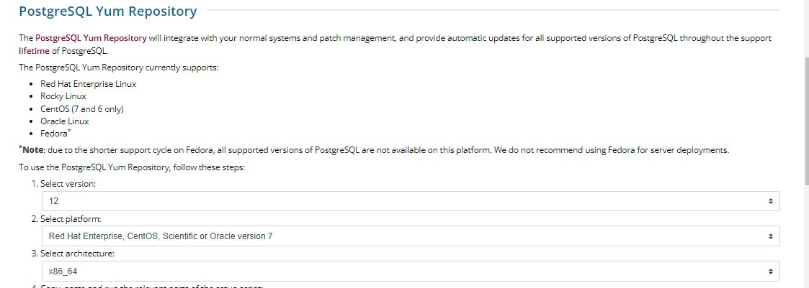
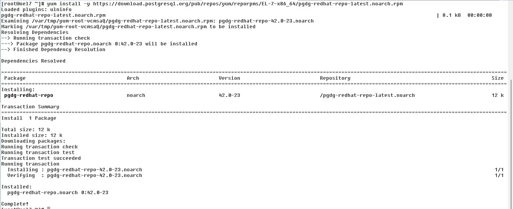
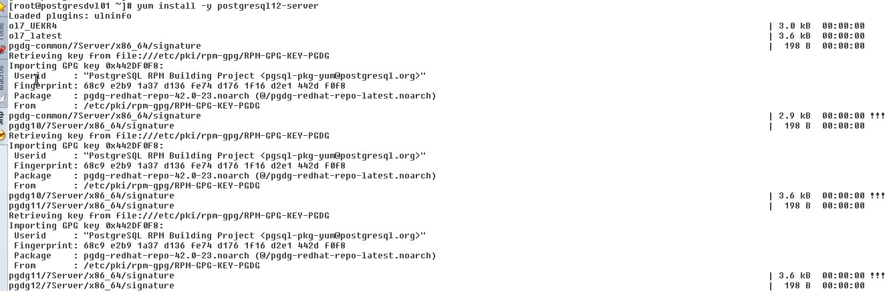
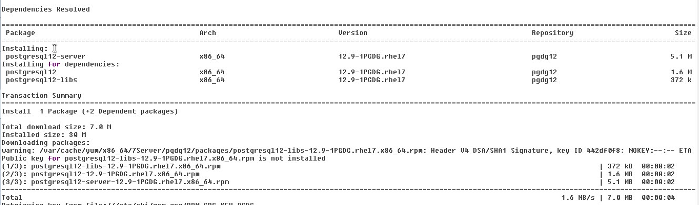
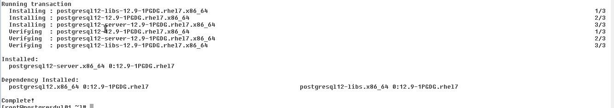
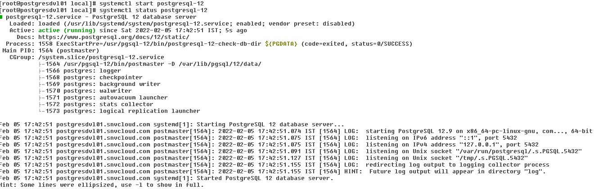
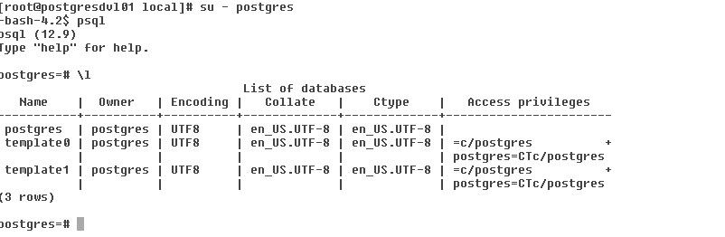

# Steps to install PostgreSQL in oel7

In this blog post, we will see how to install PostgreSQL in Oracle Linux 7

Go to the site <https://www.postgresql.org/download/linux/redhat/>

Select the appropriate version and operating system

Copy, paste and run the relevant parts of the setup script

sudo yum install -y <https://download.postgresql.org/pub/repos/yum/reporpms/EL-7-x86_64/pgdg-redhat-repo-latest.noarch.rpm>

sudo yum install -y postgresql12-server

sudo /usr/pgsql-12/bin/postgresql-12-setup initdb

sudo systemctl enable postgresql-12

sudo systemctl start postgresql-12

login as Postgres user and connect to the database and list the database

