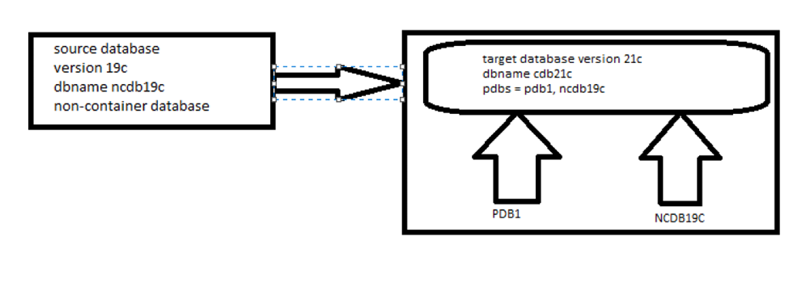

# Steps to upgrade database from non-cdb 19c to  cdb 21c

In this blog post we will see the steps how to to upgrade oracle database from non-cdb 19c to cdb  21c

## Assumptions:

1.  Already non-cdb database is configured in 19c database.
2.  A fresh installation of 21c home is done.
3.  On target new container database is configured.



Always make sure you have the database backup before proceed with upgrade.

Download the latest "autoupgrade.jar" file from [MOS 2485457.1](https://support.oracle.com/epmos/faces/DocContentDisplay?id=2485457.1). If you don't have MOS access you can miss out the next step.

``` wp-block-code
[oracle@ol7_19_vagrant admin]$ mv autoupgrade.jar autoupgrade.jar_25052024

[oracle@ol7_19_vagrant admin]$ mv /nfsshare/oracle/soft/autoupgrade.jar .
```

## Create a sample config file

``` wp-block-code
[oracle@ol7_19_vagrant admin]$ /u01/app/oracle/product/21c/dbhome_1/jdk/bin/java -jar /u01/app/oracle/product/21c/dbhome_1/rdbms/admin/autoupgrade.jar -create_sample_file config /nfsshare/oracle/pre_upgrade/config.txt full
Created sample configuration file /nfsshare/oracle/pre_upgrade/config.txt
```

Modify the entries in config file as required

``` wp-block-code
global.autoupg_log_dir=/u01/app/oracle/cfgtoollogs/autoupgrade
upg1.log_dir=/nfsshare/oracle/upgrade/ncdb19c             
upg1.sid=ncdb19c                                              
upg1.source_home=/u01/app/oracle/product/19.0.0/dbhome_1  
upg1.target_home=/u01/app/oracle/product/21c/dbhome_1  
upg1.target_cdb=cdb21c
upg1.target_pdb_name=ncdb19c
upg1.start_time=NOW                                     
upg1.upgrade_node=ol7_19_vagrant.scslabs.com                            Default is ''localhost''
#upg1.run_utlrp=[yes|no]                                  
upg1.timezone_upg=yes                               
upg1.target_version=21  
```

## Run AutoUpgrade Analyze

``` wp-block-code
[oracle@ol7_19_vagrant upgrade]$ /u01/app/oracle/product/21c/dbhome_1/jdk/bin/java -jar /u01/app/oracle/product/21c/dbhome_1/rdbms/admin/autoupgrade.jar -config /nfsshare/oracle/upgrade/ncdb19c.cfg -mode analyze
AutoUpgrade 24.4.240426 launched with default internal options
Processing config file ...
+--------------------------------+
| Starting AutoUpgrade execution |
+--------------------------------+
1 Non-CDB(s) will be analyzed
Type 'help' to list console commands

upg> lsj
+----+-------+---------+---------+-------+----------+-------+----------------------------+
|Job#|DB_NAME|    STAGE|OPERATION| STATUS|START_TIME|UPDATED|                     MESSAGE|
+----+-------+---------+---------+-------+----------+-------+----------------------------+
| 100|ncdb19c|PRECHECKS|EXECUTING|RUNNING|  22:35:32|25s ago|Loading database information|
+----+-------+---------+---------+-------+----------+-------+----------------------------+
Total jobs 1

upg> Job 100 completed
------------------- Final Summary --------------------
Number of databases            [ 1 ]

Jobs finished                  [1]
Jobs failed                    [0]

Please check the summary report at:
/u01/app/oracle/cfgtoollogs/autoupgrade/cfgtoollogs/upgrade/auto/status/status.html
/u01/app/oracle/cfgtoollogs/autoupgrade/cfgtoollogs/upgrade/auto/status/status.log
```

Review all the logs before proceeding with actual upgrade

## **Down time starts here:**

## Run AutoUpgrade Deploy mode

``` wp-block-code
[oracle@ol7_19_vagrant bin]$ /u01/app/oracle/product/21c/dbhome_1/jdk/bin/java   -jar /u01/app/oracle/product/21c/dbhome_1/rdbms/admin/autoupgrade.jar   -config /nfsshare/oracle/upgrade/ncdb19c.cfg -mode deploy
AutoUpgrade 24.4.240426 launched with default internal options
Processing config file ...
+--------------------------------+
| Starting AutoUpgrade execution |
+--------------------------------+
1 Non-CDB(s) will be processed
Type 'help' to list console commands
upg> lsj
+----+-------+-----+---------+-------+----------+-------+-------+
|Job#|DB_NAME|STAGE|OPERATION| STATUS|START_TIME|UPDATED|MESSAGE|
+----+-------+-----+---------+-------+----------+-------+-------+
| 102|ncdb19c|  GRP|EXECUTING|RUNNING|  23:10:59| 1s ago|       |
+----+-------+-----+---------+-------+----------+-------+-------+
Total jobs 1

upg> lsj
+----+-------+---------+---------+-------+----------+----------+-------+
|Job#|DB_NAME|    STAGE|OPERATION| STATUS|START_TIME|   UPDATED|MESSAGE|
+----+-------+---------+---------+-------+----------+----------+-------+
| 102|ncdb19c|PREFIXUPS|EXECUTING|RUNNING|  23:10:59|!!195s ago|       |
+----+-------+---------+---------+-------+----------+----------+-------+
Total jobs 1

upg> lsj
+----+-------+---------+---------+-------+----------+-------+------------------+
|Job#|DB_NAME|    STAGE|OPERATION| STATUS|START_TIME|UPDATED|           MESSAGE|
+----+-------+---------+---------+-------+----------+-------+------------------+
| 102|ncdb19c|DBUPGRADE|EXECUTING|RUNNING|  23:10:59|66s ago|0%Upgraded NCDB19C|
+----+-------+---------+---------+-------+----------+-------+------------------+
Total jobs 1
```

``` wp-block-code
upg> status -job 102
Details

        Job No           102
        Oracle SID       ncdb19c
        Start Time       24/05/24 23:10:59
        Elapsed (min):   72
        End time:        N/A

Logfiles

        Logs Base:    /nfsshare/oracle/upgrade/ncdb19c/ncdb19c
        Job logs:     /nfsshare/oracle/upgrade/ncdb19c/ncdb19c/102
        Stage logs:   /nfsshare/oracle/upgrade/ncdb19c/ncdb19c/102/postfixups
        TimeZone:     /nfsshare/oracle/upgrade/ncdb19c/ncdb19c/temp
        Remote Dirs:

Stages
        SETUP            <1 min
        GRP              <1 min
        PREUPGRADE       <1 min
        PRECHECKS        1 min
        PREFIXUPS        5 min
        DRAIN            2 min
        DBUPGRADE        48 min
        DISPATCH         <1 min
        NONCDBTOPDB      12 min
        POSTCHECKS       <1 min
        POSTFIXUPS       ~2 min (RUNNING)
        POSTUPGRADE
        SYSUPDATES

Stage-Progress Per Container

        +--------+----------+
        |Database|POSTFIXUPS|
        +--------+----------+
        | NCDB19C|     75 % |
        +--------+----------+

upg> Job 102 completed
------------------- Final Summary --------------------
Number of databases            [ 1 ]

Jobs finished                  [1]
Jobs failed                    [0]
Jobs restored                  [0]
Jobs pending                   [0]

Please check the summary report at:
/u01/app/oracle/cfgtoollogs/autoupgrade/cfgtoollogs/upgrade/auto/status/status.html
/u01/app/oracle/cfgtoollogs/autoupgrade/cfgtoollogs/upgrade/auto/status/status.log
```

connect to database and validate the upgraded pdb

``` wp-block-code
[oracle@ol7_19_vagrant bin]$ ss

SQL*Plus: Release 21.0.0.0.0 - Production on Sat May 25 00:26:56 2024
Version 21.3.0.0.0

Copyright (c) 1982, 2021, Oracle.  All rights reserved.

Connected to:
Oracle Database 21c Enterprise Edition Release 21.0.0.0.0 - Production
Version 21.3.0.0.0

    SQL> show pdbs

    CON_ID CON_NAME                       OPEN MODE  RESTRICTED
---------- ------------------------------ ---------- ----------
         2 PDB$SEED                       READ ONLY  NO
         3 PDB1                           READ WRITE NO
         4 NCDB19C                        READ WRITE NO
```
