# Streamlining Oracle Database Patching with AutoUpgrade.jar

Keeping Oracle databases up to date is critical for performance, security, and compliance. Recently, I explored using `AutoUpgrade.jar` for patching, and the experience has been a game-changer!

Here’s why I recommend it:  
✅ **Automation**: It simplifies the entire patching process—less manual intervention, fewer errors.  
✅ **Efficiency**: Handles multiple databases simultaneously, making the process quicker.  
✅ **Flexibility**: Supports pre-checks, patch application, and post-patching tasks, all in one workflow.  
✅ **Resilience**: In case of errors, it provides detailed logs and options for rollback.

### Key Steps I Followed:

1️⃣ Downloaded the latest `autoupgrade.jar` from Oracle Support.  
2️⃣ Configured the AutoUpgrade config file with all target databases.  
3️⃣ Ran pre-checks to identify potential issues beforehand.  
4️⃣ Executed the patching process with minimal impact on live systems.

**Tip**: Always test in a non-production environment first and ensure your backups are in place.

This tool is a must-have for any Oracle DBA aiming to reduce manual workload and improve efficiency. If you haven’t tried it yet, I highly recommend giving it a shot!

#### Demonstration:

**configuration file:**

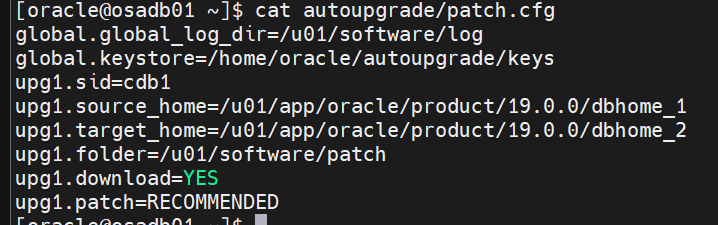

KEYSTORE : The secure directory that will contain the keystore files

SOURCE_HOME : ORACLE_HOME value of the source database

TARGET_HOME : Directory that will be used to create the new target ORACLE_HOME

SID : ORACLE_SID value of the source database

FOLDER : Directory that contains the patch zip files as well as the required base image

PATCH : Comma separated list specifying which patches to install  
\* Default value is RECOMMENDED

\* The supported values are:

RECOMMENDED : Alias for the following four options - "RU,OPATCH,OJVM,DPBP"  
RU : Latest Release Update  
RU:x.y : Release Update with the specified version (i.e., "RU:19.24")  
OPATCH : Latest OPATCH  
OJVM : Oracle Java VM patch that applies to the specified RU  
OJVM:x.y : Oracle Java VM patch with the specified version (i.e., "OJVM:19.24")  
DPBP : Datapump bundle patch that applies to the specified RU  
\<#\> : Specific one-off

When METHOD=OUTOFPLACE, the patch list must include "RU,OPATCH"

###  AutoUpgrade Patching Modes

AutoUpgrade Patching support three different job modes. Each mode runs a different set of stages.  
The action performed by each stage is outlined in the next section.

\(1\) Analyze : PRECHECKS  
(2) Fixups   : PRECHECKS, PREFIXUPS  
(3) Deploy   : GRP, PREACTIONS, PRECHECKS, PREFIXUPS, EXTRACT, INSTALL, ROOTSH, DBTOOLS,OPATCH, AUTOUPGRADE, POSTCHECKS, POSTFIXUPS, POSTACTIONS, DROPGRP

Load MOS credentials into the keystore using the -load_password command line option:

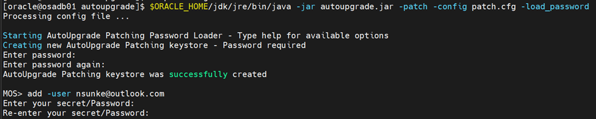

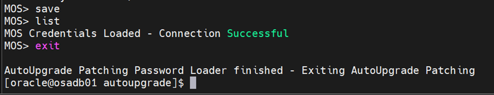

run the autoupgrade in download mode which will download the patches

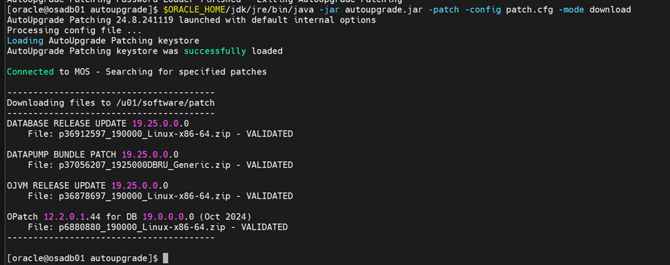

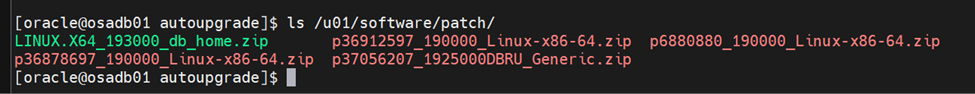

run the autoupgrade in analyze mode to the run prechecks

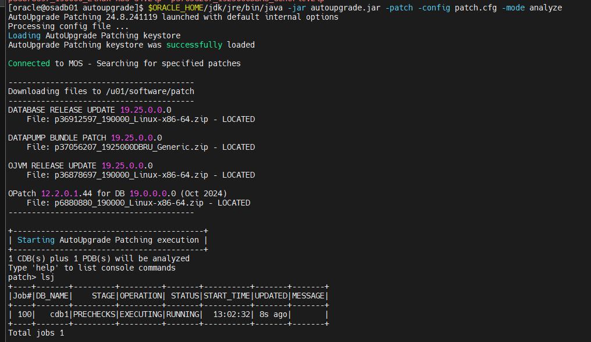

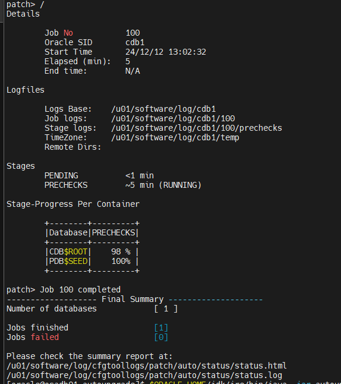

run the autoupgrade in deploy mode to the apply patch

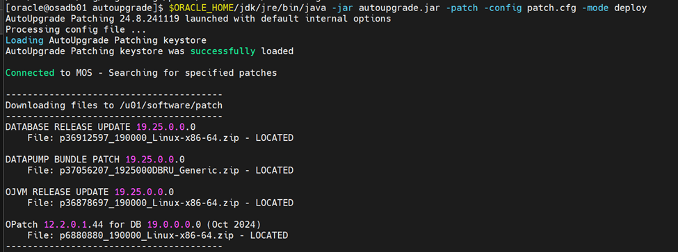

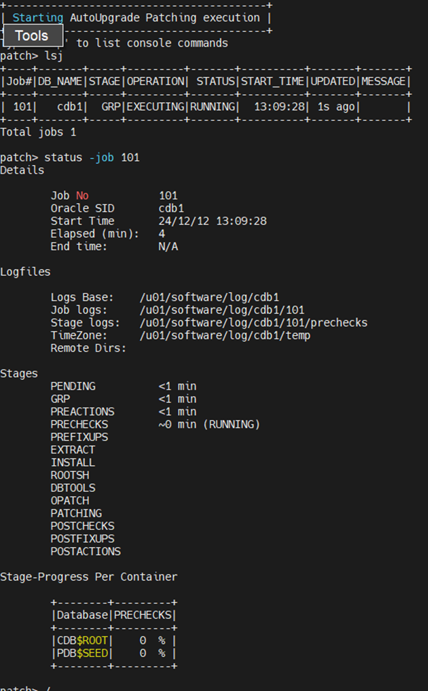

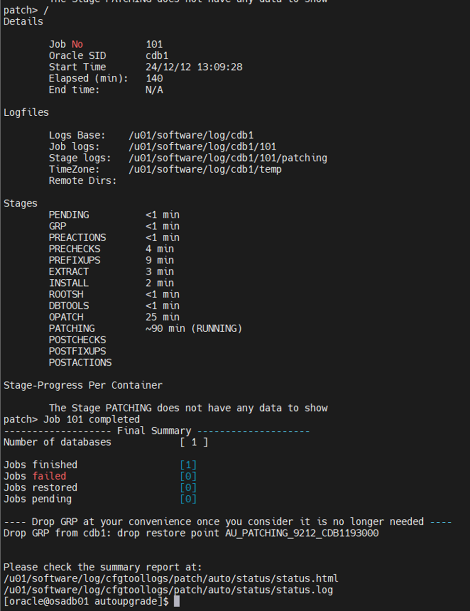

verify the applied patches

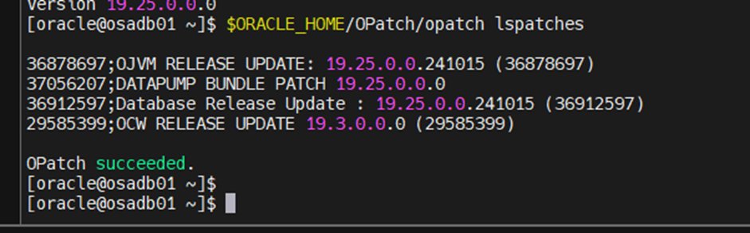
