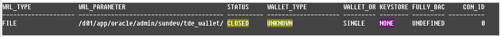
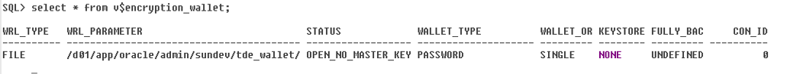
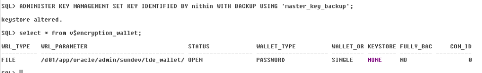

# Transparent Data Encryption (TDE)

Transparent Data Encryption (TDE) enables you to encrypt data so that only an authorized recipient can read it.

Use encryption to protect sensitive data in a potentially unprotected environment, such as data you placed on backup media that is sent to an off-site storage location.

You can encrypt individual columns in a database table, or you can encrypt an entire tablespace

To use Transparent Data Encryption, you do not need to modify your applications. TDE enables your applications to continue working seamlessly as before. It automatically encrypts data when it is written to disk, and then automatically decrypts the data when your applications access it. Key management is built-in, eliminating the complex task of managing and securing encryption keys.

Oracle Database uses authentication, authorization, and auditing mechanisms to secure data in the database, but not in the operating system data files where data is stored. To protect these data files, Oracle Database provides Transparent Data Encryption (TDE). TDE encrypts sensitive data stored in data files. To prevent unauthorized decryption, TDE stores the encryption keys in a security module external to the database, called a keystore.

 

**Benefits of Using Transparent Data Encryption**  

- As a security administrator, you can be sure that sensitive data is encrypted and therefore safe in the event that the storage media or data file is stolen.
- Using TDE helps you address security-related regulatory compliance issues.
- Data is transparently decrypted for database users and applications that access this data. Database users and applications do not need to be aware that the data they are accessing is stored in encrypted form.
- You can encrypt data with zero downtime on production systems by using online table redefinition or you can encrypt it offline during maintenance periods
- You do not need to modify your applications to handle the encrypted data. The database manages the data encryption and decryption.

  
**About Transparent Data Encryption Types and Components**

You can encrypt sensitive data at the column level or the tablespace level.

At the column level, you can encrypt data using selected table columns. TDE tablespace encryption enables you to encrypt all of the data that is stored in a tablespace.

Both TDE column encryption and TDE tablespace encryption use a two-tiered keybased architecture. Unauthorized users, such as intruders who are attempting security attacks, cannot read the data from storage and back up media unless they have the TDE master encryption key to decrypt it.

 

**Configuring Transparent Data Encryption**

Step 1: Configure the Software Keystore Location and Type  

- Log in to the server where the Oracle database resides.
- If necessary, create a wallet directory.
- \[oracle@orclncdvl01 sundev\]\$ mkdir -p /d01/app/oracle/admin/sundev/tde_wallet
- Edit the sqlnet.ora file and the following entries

  

    ENCRYPTION_WALLET_LOCATION =

    (SOURCE =(METHOD = FILE)(METHOD_DATA =

    (DIRECTORY = /d01/app/oracle/admin/sundev/tde_wallet/)))

  
   

- Log in to the database instance as a user who has been granted the SYSDBA administrative privilege

  
\[oracle@orclncdvl01 tde_wallet\]\$ sqlplus / as sysdba

SQL\*Plus: Release 19.0.0.0.0 - Production on Wed Jan 22 15:43:22 2020

Version 19.3.0.0.0

Copyright (c) 1982, 2019, Oracle.  All rights reserved.

Connected to:

Oracle Database 19c Enterprise Edition Release 19.0.0.0.0 - Production

Version 19.3.0.0.0

SQL\>

 

**Create the Software Keystore**  

- Log in to the database instance as a user who has been granted the ADMINISTER KEY MANAGEMENT or SYSKM privilege.
- Create the keystore by using the following syntax:

  

    SQL> ADMINISTER KEY MANAGEMENT CREATE KEYSTORE '/d01/app/oracle/admin/sundev/tde_wallet/' IDENTIFIED BY nithin;

    keystore altered.

  
   

    SQL> !ls

    ewallet.p12

  
After you run this statement, the ewallet.p12 file, which is the keystore, appears in the keystore location.  

- You can verify with below query weather the wallet is created or not.

  
select \* from v\$encryption_wallet

**Opening a Software Keystore**

SQL\> ADMINISTER KEY MANAGEMENT SET KEYSTORE OPEN IDENTIFIED BY nithin;

**Set the TDE Master Encryption Key in the Software Keystore**

SQL\> ADMINISTER KEY MANAGEMENT SET KEY IDENTIFIED BY nithin WITH BACKUP USING 'master_key_backup';

keystore altered.

 

In order to make auto open the wallet follow as bellow.  

    SQL> administer key management create auto_login keystore from keystore '/d01/app/oracle/admin/sundev/tde_wallet/' identified by nithin;

    keystore altered.

  
 

**Encrypt Your Data:**

You can encrypt individual columns in tables.

Whether you choose to encrypt individual columns or entire tablespaces depends on

the data types that the table has. There are also several features that do not support

TDE column encryption

 

Data Types That Can Be Encrypted with TDE Column Encryption

Oracle Database supports a specific set of data types that can be used with TDE

column encryption.

You can encrypt data columns that use a variety of different data types.

Supported data types are as follows:  

- BINARY_DOUBLE
- BINARY_FLOAT
- CHAR
- DATE
- INTERVAL DAY TO SECOND
- INTERVAL YEAR TO MONTH
- NCHAR
- NUMBER
- NVARCHAR2
- RAW (legacy or extended)
- TIMESTAMP (includes TIMESTAMP WITH TIME ZONE and TIMESTAMP WITH LOCAL

  
TIME ZONE)  

- VARCHAR2 (legacy or extended)

  
 

(Table: maximum size of encrypted data types — see the HTML page)

**Restrictions on Using TDE Column Encryption**

Do not use TDE column encryption with the following database features:  

- Index types other than B-tree
- Range scan search through an index
- Synchronous change data capture
- Transportable tablespaces
- Columns that have been created as identity columns

  
 

In addition, you cannot use TDE column encryption to encrypt columns used in foreign key constraints.

**Creating Tables with Encrypted Columns**

Creating a Table with an Encrypted Column Using the Default Algorithm

By default, TDE uses the AES encryption algorithm with a 192-bit key length (AES192).

If you encrypt a table column without specifying an algorithm, then the column is

encrypted using the AES192 algorithm.

To create a table that encrypts a column, use the CREATE TABLE SQL statement with the ENCRYPT clause. For example, to encrypt a table column using the default algorithm:

   

    create table emp(

    first_name  varchar2(20),

    last_name   varchar2(30),

    emp_id      number(5),

    salary      number(5,2) encrypt);

  

    SQL> desc emp;

    Name                                      Null?    Type

    ----------------------------------------- -------- 

    FIRST_NAME                                         VARCHAR2(20)

    LAST_NAME                                          VARCHAR2(30)

    EMP_ID                                             NUMBER(5)

    SALARY                                             NUMBER(5,2) ENCRYPT

  
Creating a Table with an Encrypted Column Using No Algorithm or a NonDefault Algorithm

To create a table that uses an encrypted column that is a non-default algorithm or

no algorithm, run the CREATE TABLE SQL statement as follows:

– If you do not want to use any algorithm, then include the ENCRYPT NO SALT

clause.

– If you want to use a non-default algorithm, then use the ENCRYPT USING

clause, followed by one of the following algorithms enclosed in single

quotation marks:

\* 3DES168

\* AES128

\* AES192 (default)

\* AES256

The following example shows how to specify encryption settings for the empID and

salary columns.  

    CREATE TABLE employee (

    first_name VARCHAR2(128),

    last_name VARCHAR2(128),

    empID NUMBER ENCRYPT NO SALT,

    salary NUMBER(6) ENCRYPT USING '3DES168');

  
   

    SQL>  desc employee

    Name                                      Null?    Type

    ----------------------------------------- -------- 

    FIRST_NAME                                         VARCHAR2(128)

    LAST_NAME                                          VARCHAR2(128)

    EMPID                                              NUMBER ENCRYPT

    SALARY                                             NUMBER(6) ENCRYPT

  
In this example:  

- The empID column is encrypted and does not use salt. Both the empID and salary columns will use the 3DES168 encryption algorithm, because all of the encrypted columns in a table must use the same encryption algorithm.

  
 

Using the NOMAC Parameter to Save Disk Space and Improve Performance You can bypass checks that TDE performs. This can save up to 20 bytes of disk space per encrypted value.

If the number of rows and encrypted columns in the table is large, then bypassing TDE checks can add up to a significant amount of disk space. In addition, this saves processing cycles and reduces the performance overhead associated with TDE.

Example 3-1 Using the NOMAC parameter in a CREATE TABLE statement  

    CREATE TABLE employee (

    first_name VARCHAR2(128),

    last_name VARCHAR2(128),

    empID NUMBER ENCRYPT 'NOMAC' ,

    salary NUMBER(6));

  
 

**Changing the Integrity Algorithm for a Table**  

    ALTER TABLE EMPLOYEE REKEY USING '3DES168' 'SHA-1';

    ALTER TABLE EMPLOYEE REKEY USING '3DES168' 'NOMAC';

  
 

 

**Changing the Encryption Key or Algorithm for Tables with Encrypted Columns**

You can use the ALTER TABLE SQL statement to change the encryption key or algorithm used in encrypted columns.

Each table can have only one TDE table key for its columns. You can regenerate the TDE table key with the ALTER TABLE statement. This process generates a new key, decrypts the data in the table using the previous key, reencrypts the data using the new key, and then updates the table metadata with the new key information. You can also use a different encryption algorithm for the new TDE table key.  

- To change the encryption key or algorithm for tables that contain encrypted columns, use the ALTER TABLE SQL statement with the REKEY or REKEY USING clause.

  
 

For example:  

    ALTER TABLE employee REKEY;

    ALTER TABLE employee REKEY USING '3DES168';

  
 

**Changing the Password-Protected Software Keystore Password**  

    ADMINISTER KEY MANAGEMENT ALTER KEYSTORE PASSWORD [FORCE KEYSTORE] IDENTIFIED BY old_password SET new_password [WITH BACKUP [USING 'backup_identifier']];
