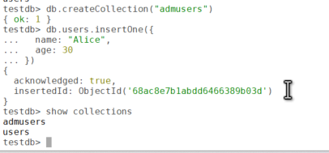
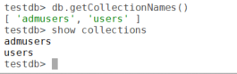

# Understanding Collections in MongoDB

MongoDB, a leading NoSQL database, stores data in a flexible, JSON-like format called BSON (Binary JSON). At the core of its data organization are **collections**, which serve as the primary structure for storing documents. This blog post explores what collections are, their characteristics, and how to work with them effectively.

## What is a Collection in MongoDB?

In MongoDB, a **collection** is a group of documents, analogous to a table in a relational database. However, unlike tables, collections are schema-less, meaning documents within a collection can have different structures, fields, and data types. This flexibility makes MongoDB ideal for handling dynamic, unstructured, or semi-structured data.

For example, a collection named users might contain documents like:

``` wp-block-code
{
  "_id": 1,
  "name": "Alice",
  "age": 30,
  "city": "New York"
}
{
  "_id": 2,
  "name": "Bob",
  "email": "bob@example.com"
}
```

Notice that the two documents have different fields (age and city vs. email), yet they coexist in the same collection.

## Key Characteristics of Collections

1.  **Schema-less Design**: Documents in a collection can have varying structures, allowing for flexibility in data modeling.
2.  **Dynamic Creation**: Collections are created automatically when you insert a document into a non-existent collection.
3.  **No Fixed Size**: Collections can grow dynamically as more documents are added, limited only by the system's resources.
4.  **Hierarchical Organization**: Collections reside within a database, and a single MongoDB instance can host multiple databases, each with multiple collections.

## Creating and Managing Collections

### Creating a Collection

You can create a collection **explicitly** using the createCollection method or **implicitly** by inserting a document. Here's how:

**Explicit Creation**

``` wp-block-code
db.createCollection("admusers")
```

**Implicit Creation**

``` wp-block-code
db.users.insertOne({
  name: "Alice",
  age: 30
})
```



This command creates the users collection if it doesn't already exist and inserts the document.

### Viewing Collections

To list all collections in a database:

``` wp-block-code
db.getCollectionNames()
show collections
```



### Dropping a Collection

To remove a collection and all its documents:

``` wp-block-code
db.users.drop()
```

## Best Practices for Using Collections

- **Logical Grouping**: Use collections to group related documents, such as users, orders, or products, to maintain a clear data model.
- **Naming Conventions**: Use clear, descriptive names for collections (e.g., users instead of u). Avoid spaces and special characters.
- **Capped Collections**: For use cases like logging, consider capped collections, which have a fixed size and automatically overwrite old data:

``` wp-block-code
db.createCollection("logs", { capped: true, size: 5242880, max: 1000 })
```

## Common Use Cases

Collections are versatile and support various applications:

- **User Data**: Storing user profiles with varying attributes.
- **E-commerce**: Managing product catalogs with diverse attributes like size, color, or price.
- **Analytics**: Storing time-series data or event logs.
- **Content Management**: Handling articles, posts, or comments with flexible schemas.

## Conclusion

Collections in MongoDB provide a flexible and powerful way to organize and manage data. Their schema-less nature allows developers to adapt to changing requirements without rigid constraints, while their integration with MongoDB's query language supports efficient data manipulation. By understanding collections and following best practices, you can build scalable and robust applications with MongoDB.

To dive deeper, explore MongoDB's official documentation or experiment with collections in a local or cloud-based MongoDB instance.
