# Upgrading Oracle Database  12.2.0.1 PDB to 19c

In this blog we will see how to upgrade the pluggable database from 12.2.0.1 version to 19c version.

Assumptions:

1.  source and target vms are already built and ready for upgrade
2.  source db version is 12.2.0.1 and target db version is 19c
3.  An nfs share is configure between source and target for file copy.

## Check plug-in compatibility of the PDB in the new release CDB

We will start by checking whether my PDB can be plugged into the new release CDB.

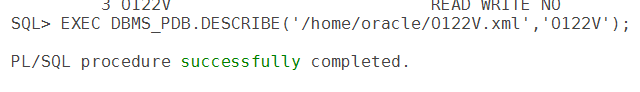

copy the file to the nfs share

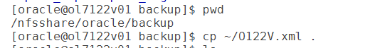

check plug-in compatibility on target system

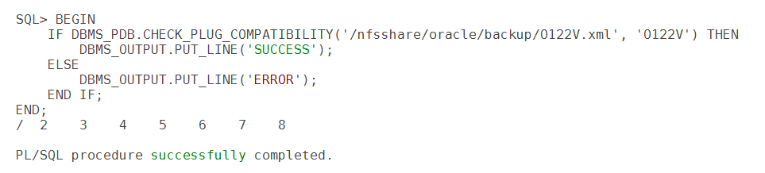

## Create a refreshable PDB on the new system

While I wait for downtime to start, I will create a refreshable PDB. I need to copy the PDB to the target system and to avoid doing that during downtime, I will use the refreshable PDB feature. When I refresh it, it will only need to apply the recent-most changes from the source PDB which is much faster than a full clone, obviously. I need a common user in the source CDB that can be used by the database link over which the cloning will take place:

## **on source database:**

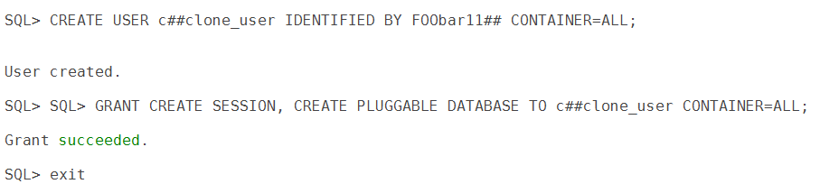

In the target CDB, create a database link that points to the source CDB:

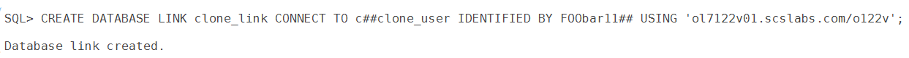

Check that it works

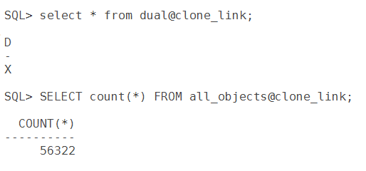

create the refreshable PDB. we will set it to `REFRESH MODE MANUAL`.

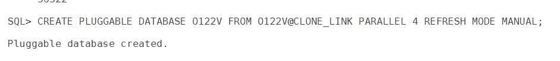

You can periodically refresh the PDB to further minimize the final refresh time:

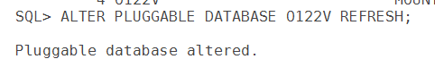

for testing create a sample test table in sys schema under O122V pdb on source.

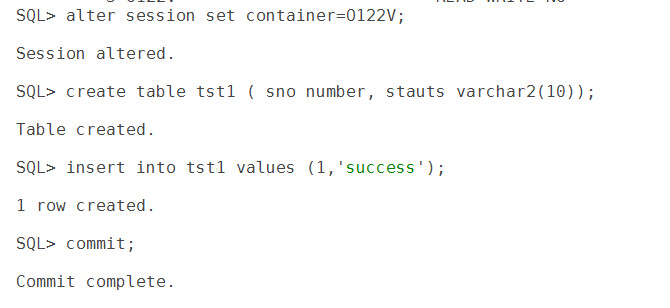

now on source close the pdb and do a final refresh of pdb at target

## source pdb:

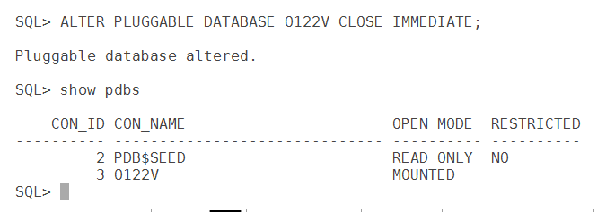

## on target:

do the final refresh:

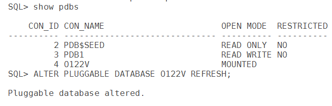

it is time to convert the refreshable PDB into a regular PDB

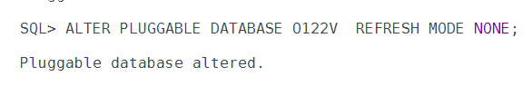

Lets perform actual upgrade of pdb

open pdb in *upgrade* mode

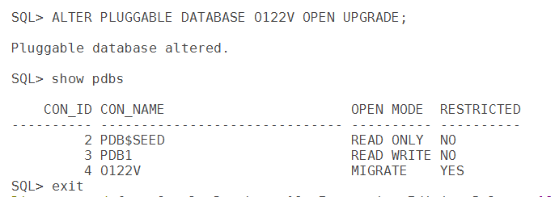

run dbupgrade to upgrade the pdb

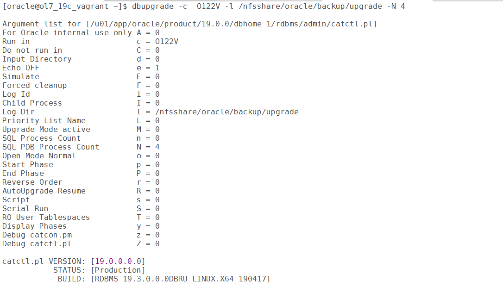

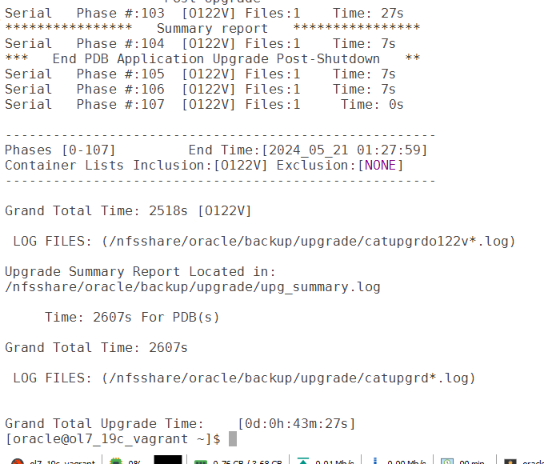

open the pluggable database and validate the data

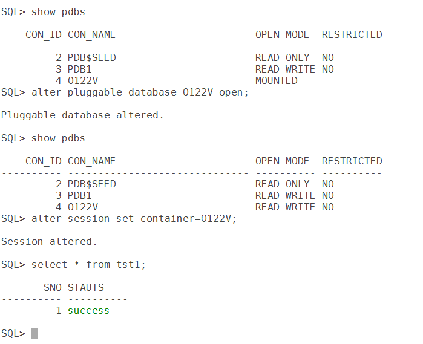
